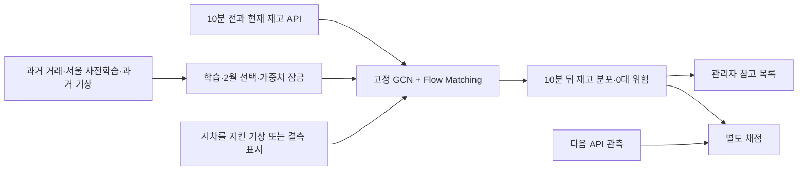

# H-0013 · 실제 API를 받는 10분 재고 예측

## 가설

직전·현재 관측으로 다음10분의 API 표시재고와0대 위험을 예측한다. 서울 미래 거래 예측 encoder + 타슈 GCN + **조건부 Flow Matching**을 주후보로 정했다.
현재유지와 동일 recent-GCN Poisson 모두보다 fairCRPS를1% 초과 줄이고, 도시동기화3일/7일 구간 하한도1%를 넘어야 지지한다.
[동결 계획](../research/hypotheses/H-0013.json)과 [입력 해시](../research/datasets/tashu-rolling-api-H0013-v1.json)는 학습 전 커밋 `457e02eeaedb78e51616082573afe30417fdc6fb`에 게시했다.

[Flow Matching 원문](https://arxiv.org/html/2210.02747v2)의 조건부 벡터장 회귀와
[Ferro의 공정 ensemble 점수](https://empslocal.ex.ac.uk/people/staff/ferro/Publications/ferro2013.pdf)를 참고한다.
[재배치 RL 원문](https://www.cirrelt.ca/documentstravail/cirrelt-2024-04.pdf)의 행동·보상·운영 모형은 향후 단계로 둔다.

## 실험



### 자료와 관측 경계

| 구분 | 기간·역할 |
|---|---|
| 과거 학습 | 2024-08~2026-01 완료 대여·반납. 잘못 표기된2025-12 제외. canonical 원본9,320,018행 중9,116,463건 수락 |
| 내부 선택 | 2026-02 완료 거래 건수만. API 미사용 |
| 거래 보조 | 2026-03 고정32,768 대여소·시점. 실측 재고 정답 없음 |
| 공식 재고 평가 | 2026-09 API, 실제9/17~30. 반복 노출된 공식 재사용 평가이며 미열람 독립시험 아님 |
| 새 실제 회차 | 2026-10-31 21:20·21:30 입력→21:40 관측. 추가 연결 확인, 공식9월의 대체 아님 |

기존 주간 제한 대신24시간/10분 건수를 새로 집계했다. 87,552칸 중72,744칸이 원본 월·월경계·도시 기록 지원 조건을 만족했고,
10분 합과30분 집계가 일치했다. 과거전용1,318개 고정 ID·OD·420차원 프로필·첫 기록을 재사용했다.
첫 기록 전과 기록 지원 밖의 시간은 노출0 정답으로 만들지 않았다. 이 지원 마스크는 실제 운영·공급 노출을 관측한 것이 아니다.

API의 직전 재고 차이는 거래·재배치·수리·서버 조정이 섞인 **최근 순흐름 대리 입력**이다. 학습의 완료 거래 순흐름과 동일하다고 확정하지 않는다.
현재·직전 관측만으로 모든 현재 유효 지원 ID에 먼저 예측을 발행한 뒤, 미래 유효성을 채점에서만 적용했다.
수집지연0~120초, 실제 경과480~720초, 명목 예측600초다. 미래 실제 경과로 예측 시간을 조절하지 않는다.
이전 관측 누락은 mask, 추세 기준선은 현재유지 fallback이다. 누락 관측은0대로 채우지 않는다.

### 모형·학습·생성

- 서울 H12 source-only encoder만 초기값으로 가져와 타슈 전체 모형을 미세조정했다. source 예측망·API 학습 가중치를 승계하지 않는다.
- GCN은 own/neighbor 맥락256차원과 추가 선형층2개, 317,122개 모수/시드다. 과거 월·주간률,24시간 달력,10분 phase,54개 기상,표현64개,최근 대리값과 mask를 쓴다.
- no_recent/recent 각2시드11/29,16epoch+0,epoch524,288표본/batch8,192. February 전체 건수 deviance로 checkpoint를 선택했다.
- recent-GCN hidden256에 조건화한 CountFlow는67,202개 모수/시드,20epoch+0 같은 표본 예산이다. 고정131,072개2월 표본·고정 noise의 flow-loss로 선택했다.
- 독립 Gaussian coupling으로 `log1p(count+U)-log1p(rate)` 잔차의 벡터장을 학습했다. Heun16으로 역변환하고 비유한/65,535 초과는 수치 실패로 처리한다.
- 각 입자마다11/29 시드 모형을 독립 선택하는128개 IID mixture다. 재고는 모든 계수형 후보에 동일하게 `max(0,현재+반납-대여)`로 연결한다.
- 이는 대여소별2차원 완료 거래 분포다. 사건 순서·물리 수용량·도시 전체 공동 시나리오·운영자 행동을 복원한 모형은 아니다.

기상은 primary/공항 GHCNh6파일과 기상청 대전133의27개월을 고정했다. 시간별은 issue−1시간 이전/최대4시간 나이,
일별은 KST날짜−2만 사용한다. numeric/dash/missing을 구분한다. 사후 수정·실시간 수신 상태는 검증하지 못했다.
새 실제 회차에서는 archive가 오래돼 모든 주요 기상을 결측으로 표시했다. **실시간 기상 연결 완료로 보고하지 않는다.**

### 실행 위치와 검사

제공된 채팅 AGENTS의 dislab 지정을 늦게 대조해 과거 학습을 로컬 RTX4060Laptop에서226.4초 실행했다.
이는 실행 위치 위반으로 보존한다. 최대GPU할당3,547.9MiB다. 로컬 부분 API 평가는 중단했고 전체 평가에 합치지 않았다.
동일한 고정 모델로 **dislab RTX3080의 전체9월 평가·새 실제 추론·채점**을 수행했다. 학습/평가 환경 차이는
[실행 경위](../research/runs/H-0013-20261031-rolling-api/execution-deviations.json)와 manifest에 공개하며 동결 계획을 수정하지 않는다.

dislab에서 의미·시각 확인14개 검사, 고정 코드12개 해시, 저장 모형16개 CPU/GPU 기대건수 비교를 확인했다.
최대 차이1.49e-7은 허용2e-5 이내다. 동일입력 표본 재현과 손상 해시 거부도 확인했다.
공식 평가 계산은1167.9초이며 native 원격 시계의 약135~137초 지연을 별도 기록했다.
새 예측의 인과 순서는 같은 수집기 시계로 정답 전에 확인했다. 원격 원래 시각과 원본·정정 해시는 보존했고 예측값은 바꾸지 않았다.

## 결과

**사전 지표 판정: `not_supported`.** 실행 위치의 계획 불일치를 별도 제약으로 함께 보고한다.
9월 1,298개 대여소의 2,458,501쌍을 동일 표본에서 비교했다.
9월 실제 관측 ID는1,378개이고, 그중 과거 모형 미지원은80개다.

| 모델 | fairCRPS ↓ | 중앙값 MAE, 대 ↓ | 평균 RMSE, 대 ↓ | 0대 Brier ↓ | 정확히 일치 | ±1대 이내 |
|---|---:|---:|---:|---:|---:|---:|
| 현재 유지 | 0.212015 | 0.212015 | 0.600705 | 0.061430 | 83.49% | 96.70% |
| 최근 API 추세 | 0.319797 | 0.319797 | 0.792911 | 0.072692 | 77.43% | 93.80% |
| GCN·최근 입력 없음·Poisson | 0.179454 | 0.211553 | 0.586899 | 0.053072 | 83.46% | 96.71% |
| GCN·최근 입력·Poisson | 0.179170 | 0.212039 | 0.587437 | 0.052824 | 83.43% | 96.70% |
| GCN·최근 입력·Flow Matching | 0.179756 | 0.211982 | 0.588174 | 0.053544 | 83.43% | 96.71% |

CFM의 fairCRPS 상대 개선은 현재유지 대비 **15.215%**,
recent Poisson 대비 **-0.327%**다. 주지표는 두 값의 최소 **-0.327%**다.
높은 단순 적중률만으로 유용성을 판단하지 않고 동일표본 현재유지와 비교한다.
대수 중앙값 MAE는 현재유지0.212015대와 CFM0.211982대로 거의 같다. 15.215%는 확률분포 점수의 감소이며 대수 오차 감소율이 아니다.
판정 범위는 이번 표현·예산·선택 규칙에 한정한다. H13은 서울 사전학습이나 GCN 자체의 추가 효과를 분리하지 않았고,
CFM 대 Poisson은 생성 head·학습 목적을 묶은 비교다. 상관 하나의 인과 효과를 확인한 실험은 아니다.

| 날짜 블록 | 최소 대조군 상대 개선 95% 구간 |
|---|---:|
| 3일 | [-1.116%, 0.018%] |
| 7일 | [-0.704%, -0.034%] |

날짜별 도시 동기화 block2000회이며14개 calendar-day 축의 빈날도 포함했다. 고정 fit·선택·Monte Carlo 규칙에 조건화한 구간이다.
표본 수가 많아도 독립 현장 관측이 그만큼 있다는 뜻은 아니다. API 오차를 보고 모델·분포·보정·임계값을 다시 선택하지 않았다.

| 현재 상태 | 쌍 수 | 현재유지 fairCRPS | recent Poisson fairCRPS | CFM fairCRPS | CFM 0대 Brier |
|---|---:|---:|---:|---:|---:|
| 현재 0대 | 1,128,898 | 0.081535 | 0.071355 | 0.073218 | 0.059792 |
| 현재 양수 | 1,329,603 | 0.322799 | 0.270711 | 0.270212 | 0.048238 |
| 실제 경과 ±30초 보조 | 2,458,501 | 0.212015 | 0.179170 | 0.179756 | 0.053544 |

CFM의5~95% 표본 구간 포함률은97.21%다. 이를 확률 보정 완료로 해석하지 않는다.

### 과거 건수와 실제 연결 회차

3월 보조 deviance는 no_recent Poisson0.423542 / recent Poisson0.423828 / CFM0.427859,
energy는0.155346 /0.155168 /0.159041이었다. 과거 보조에서 CFM 개선을 관측하지 못했다. 이 수치는 재고 정확도가 아니다.

실제 API에서21:20·21:30 관측으로21:40 표시재고를 예측했다. **21:31:11 수집기 기준으로 발행을 확인한 뒤21:40:00 실측을 받아 1,296쌍을 dislab에서 채점**했다.
첫 미래 관측 성공 후 수집을 종료했다. 원격 시계 지연으로 보정한 것은 발행 증거의 시각 메타데이터이며 이미 만든 예측값은 유지했다.
한 시점의 기능·추가 관측 결과로 일반 정확도·장기 운영 개선을 주장하지 않는다.

### 채택 범위와 다음 행동

최근 API를 읽는 GCN·Flow Matching 예측 경로, 별도 채점과 관리자 참고 출력 코드를 연구 시제품으로 보존한다.
API를 가중치 갱신·재학습·승자 선택에 재사용하지 않는다. 현재 예측의0대 위험 상위10개와 현재0대 목록은 참고용이다.
차량 수·적재량·거점은 미확인 값이며 재배치 행동을 생성하거나 효과를 검증한 것으로 취급하지 않는다.
RL은 향후 `state/action/cost/outcome` 운영 로그와 자원 제약을 갖추고 이 예측 상태를 이용해 행동을 선택하는 별도 단계다.

다음 연구는 **과거 내부 검증에서 CFM의 건수 분포 손실과 선택 기준을 직접 확인**하고 실제 기상 수신을 보완하는 새 계획이다.
이번9월 재사용 평가를 재튜닝 근거로 삼지 않는다. 신규 현장 관측은 동결한 모델의 추가 외부 관측으로 축적한다.
새 실시간 경로는 독립 CLI·수집 연결로 구현했으며 기존8768 시연 화면은 이전H9 모델을 사용한다.

[전체 집계](../research/runs/H-0013-20261031-rolling-api/summary.json), [실행 manifest](../research/runs/H-0013-20261031-rolling-api/manifest.json),
[학습 trace](../research/runs/H-0013-20261031-rolling-api/training.json), [실제 회차](../research/runs/H-0013-20261031-rolling-api/live-roundtrip.json)를 보존한다.
원본·인증값·개별 재고·가중치·접속 주소는 공개하지 않는다. PR20은 병합하지 않는다.

```text
python research_code/rolling_inventory_fit.py --history-dir PRIVATE_HISTORY --parent-dir PRIVATE_H12 --weather-dir PRIVATE_WEATHER --out PRIVATE_FIT
python research_code/rolling_inventory_evaluate.py --fit-dir PRIVATE_FIT --panel PRIVATE_API_PANEL --weather-dir PRIVATE_WEATHER --out PRIVATE_EVALUATION
python research_code/rolling_inventory_predict.py predict --fit-dir PRIVATE_FIT --snapshot PRIVATE_CURRENT --previous PRIVATE_PREVIOUS --weather-dir PRIVATE_WEATHER --out PRIVATE_ORIGINAL_FORECAST
python research_code/rolling_inventory_receipt.py --forecast PRIVATE_ORIGINAL_FORECAST --out PRIVATE_CONFIRMED_FORECAST
python research_code/rolling_inventory_predict.py score --forecast PRIVATE_CONFIRMED_FORECAST --snapshot PRIVATE_FUTURE --out PRIVATE_SCORE
```
