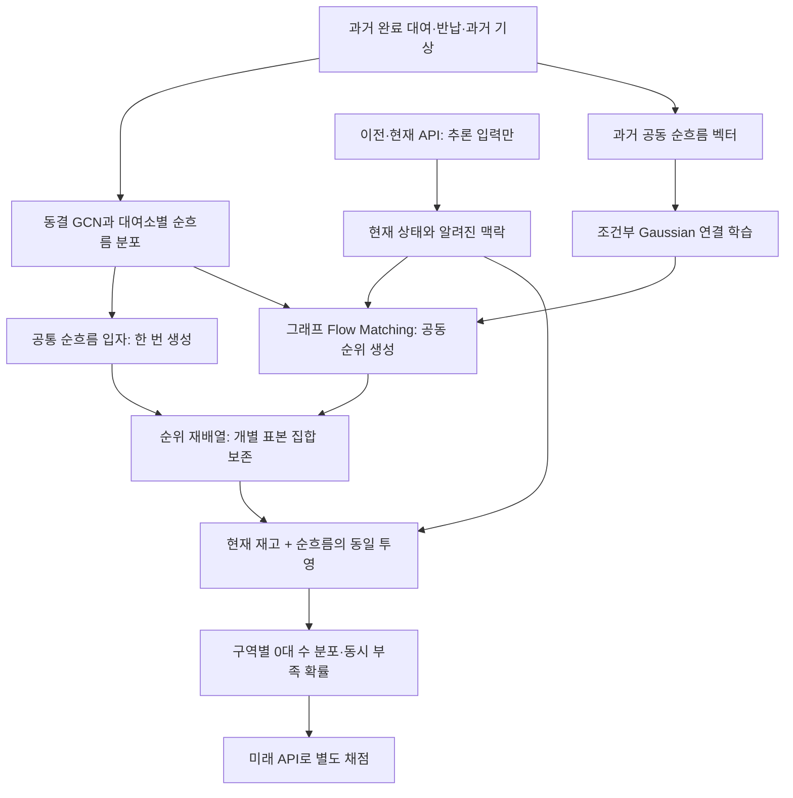

# H-0014 · 대여소별 예측을 보존하며 동시 부족을 학습하는 Flow Matching

상태: **계획 동결·dislab 학습 완료·사전 과거 기준 실패로 외부 평가 전 철회**.
[실제 결과](H-0014-experiment-results.md)에서 Gaussian 대비 FM 추가 개선 0%와 새 9월 API 평가 미실행을 보고한다.
H13의 동결 계획·결과를 바꾸지 않는다. 아래 1·2절은 최초 설계 논리를 보존한다.
당시의 제안·예산안·미확정 값은 학습 전 게시한 [정확한 실행계획](../research/plans/H-0014-v1.json)으로 구체화했다.

## 1. 가설

**GCN이 대여소별 예측을 담당하고, Flow Matching은 여러 대여소가 함께 변하는 공동 시나리오를 담당한다.**
관리자 출력은 10분 뒤 구역 안의0대 대여소 수, 동시 부족 확률과 그 불확실성이다.
동일한 대여소별 분포 아래 FM의 비선형 의존성 학습이 독립 연결·단순 Gaussian 연결·현재유지보다 구역 위험 예측을 개선하는지 검증한다.

개별 대여소 MAE를 개선하는 일은 주변분포 모형의 별도 목표다. H14는 **주변분포를 동일하게 고정하고 공동위험의 추가 가치를 식별**한다.
이를 H13의 실패를 바꾸는 새 성공으로 해석하지 않는다. 공동 예측 성능과 실제 재배치 비용 절감도 구분한다.

### 왜 이 역할을 검토하는가

H13의 FM은 대여소마다 대여·반납2차원 분포를 만들었다. GCN이 이웃의 맥락을 전달해도,
발행 시점의 맥락을 고정한 뒤 대여소별 독립 잡음을 별도로 변환하면 그 자체로 대여소 간 공동 난수를 학습하는 구조는 아니다.
관리자가 동시에 대응해야 하는 곳이 몇 군데일지 계산하려면 대여소 간 확률 의존성이 필요하다.

과거3월 완료 거래 보조에서 H13의 CFM은 recent Poisson보다 deviance/energy가 낮지 않았다.
이는 과거 정답으로 확인한 범위이며 원인이 특정 loss·변환·용량 때문이라고 입증한 결과는 아니다.
FM 학습 loss와 최종 분포 품질을 나누어 보고, 새 계획에서는 실제 생성 분포의 공동 지표로 checkpoint를 선택한다.
9월 API의 오차·분산·성능 순위를 새 구조·분포·임계값 선택의 근거로 사용하지 않는다.

### 선행연구가 주는 근거와 한계

| 원문 | 확인한 내용 | 이번 적용과 한계 |
|---|---|---|
| [ECC, Schefzik 외2013](https://arxiv.org/html/1302.7149) §3–4 | 주변분포 표본을 공동 순위에 맞게 재배열 | FM이 순위 템플릿을 생성하도록 제안. 재배열 자체가 예측 개선을 보장하지 않음 |
| [Gaussian Copula, NeurIPS2019](https://proceedings.neurips.cc/paper/2019/file/0b105cf1504c4e241fcc6d519ea962fb-Paper.pdf) §2–4 | 저차원+대각 공분산과 주변분포 변환 | 강한 단순 의존성 대조군. 원래 RNN 전체 재현은 아님 |
| [Variogram Score, Scheuerer·Hamill2015](https://repository.library.noaa.gov/view/noaa/22327/noaa_22327_DS1.pdf) §2 | 의존성에 민감한 평가, ES의 한계 | 지역 집계 CRPS와 VS0.5를 함께 사용. 한 지표로 공동분포 전체를 보증하지 않음 |
| [GP-prior FM, ICLR2025](https://proceedings.iclr.cc/paper_files/paper/2025/file/ee1a1ecc92f35702b5c29dad3dc909ea-Paper-Conference.pdf) | 구조 있는 prior와 시계열 예측, flow-time 구분 | 조건부 Gaussian prior를 출발점으로 검토. 원문은 단변량 설정이므로 대여소 그래프 효과의 증거가 아님 |
| [Count-FM, Wei·Pearson2026 preprint](https://arxiv.org/html/2605.07746) §2 | 정수 공간의 birth/death 학습 | 후속 주변분포 비교 후보. 생성 과정의 birth/death를 실제 대여·반납·운영 이동으로 간주하지 않음 |

원문별 확인 범위는 [문헌 카드](sources/H-0014-flow-matching-literature.json)에 남긴다. 신규성을 주장하지 않는다.

### 설명용 예시: 같은 대여소 예측도 관리자에게는 다르다

아래는 **설명용 가상4개 시나리오**이며 타슈 관측이나 실험 결과가 아니다.

| 시나리오 | 독립 연결 A/B 재고 | 함께 부족한 연결 A/B 재고 |
|---|---|---|
| 1 | 0 / 0 | 0 / 0 |
| 2 | 0 / 5 | 0 / 0 |
| 3 | 5 / 0 | 5 / 5 |
| 4 | 5 / 5 | 5 / 5 |

A와B 각각의0대 확률은 양쪽 모두50%, 재고 표본도 각각 `[0,0,5,5]`로 같다.
두 곳이 동시에0대인 확률은25%와50%다. FM이 맡을 가치는 어느 연결이 실제 과거 패턴과 맞는지 학습하는 것이다.
이 예시로 실제 대응 차량 수·비용이나 FM의 우월성이 확인되는 것은 아니다.

## 2. 실험 설계

### 구조와 출력 계약

모듈 경계는 `MarginalEngine → DependenceTemplate → RankCoupler → InventoryProjector → RegionalRisk`다.
각 모듈의 변경을 분리해 검증한다. 학습 자료는 과거 완료 거래, API는 동결 이후 추론·외부 평가 전용이다.

#### A. 개별 대여소 예측을 고정한다

H13의 **사전 정의된 recent-GCN Poisson 두 시드11/29**와 과거전용 context를 모두 고정 참조한다.
선정 근거는 완료 계수의 해석·차이분포 CDF 계산 가능성과 과거 거래 보조 근거다. API 순위로 variant/seed를 고르지 않는다.
선택 이력은 입력 manifest에 기록하고, 다른 주변분포로 바꾸는 비교는 별도 가설로 분리한다.

다음10분 순흐름을 `D_i=반납_i−대여_i`로 정의한다. 두 계수의 독립 Poisson 차이와 고정2시드 혼합으로 주변 CDF `F_i(d|c)`를 얻는다.
각 발행마다 모든 주변분포 비교군이 공유할 정수 입자 `d_i^(1..M)`를 **한 번만** 만든다. 시작 제안은 M=128이다.
H13 기존 저장 예측과 비트 단위로 같다는 뜻은 아니며, 같은H14 입력·공통 입자에서 비교군 간 동일성을 보장하는 계약이다.

#### B. FM은 전체 지원 대여소의 공동 순위를 생성한다

과거 한 시점의 지원 대여소 순흐름 벡터가 한 학습 표본이다. 대여소를 독립 학습 표본으로 쪼개지 않는다.
이산 CDF의 randomized PIT `u_i=F_i(D_i−1|c)+v_i·P(D_i|c)`를 만들고 `z_i=Phi^-1(clip(u_i,eps,1−eps))`로 변환한다.
`v_i`는 대여소·시점별 **독립** Uniform이다. 공유 jitter로 가짜 의존성이 생기지 않도록 검사한다.
eps는 수치 설정이며 과거 감사 후 동결한다. 이산 자료의 latent copula가 유일하거나 PIT가 실제로 보정됐다고 가정하지 않는다.

출발 분포는 과거에서만 학습한 조건부 저차원 Gaussian `Z_0=L(c)g+diag(s(c))e`다.
`g`는 한 시나리오의 공통 요인, `e`는 대여소별 잡음이다. 대각 분산을 정규화해 안정성을 검사한다.
FM은 같은 발행 맥락의 이 prior와 실제 과거 `Z_1` 사이의 조건부 벡터장을 학습한다:

`Z_a=(1−a)Z_0+aZ_1`, `loss=E[masked ||v_theta(Z_a,a,c)−(Z_1−Z_0)||²]`.

`a∈[0,1]`은 **생성 계산의 시간**이다. 실제 다음10분 동안 자전거가 이동한 경로를 의미하지 않는다.
한 도시 시점 안의 latent를 GCN 메시지와 공통 요인으로 연결한다. 잡음이 들어오는 경로까지 연결되어야 공동 시나리오를 학습한다.
서로 다른 발행 맥락을 무조건 섞는 minibatch-OT는 이번 기본안에서 제외한다.

조건 `c`는 과거 프로필/그래프, GCN 맥락, 달력, 예측 시작 전에 알려진 기상·최근 순흐름 대리값과 결측 표시다.
학습의 최근 완료 순흐름과 추론의 API 차이는 같은 변수가 아니다. API 차이에 운영 이동·수리·보정이 섞인 한계를 유지한다.
현재 API 재고는 추론의 투영 시작 상태로만 쓰며 과거 재고 정답이 있는 것처럼 학습하지 않는다.

#### C. 개별 분포를 보호하는 재배열

FM 시나리오의 대여소별 순위 `r_i(m)`로 공통 정수 입자를 연결한다:

`Dhat_i^(m)=sort(d_i)[r_i(m)]`, `Shat_i^(m)=max(0,S_now_i+Dhat_i^(m))`.

각 `r_i`가 순열이면 정렬한 순흐름 표본 집합은 그대로다. 현재 상태에 같은 단조 투영을 적용한 재고 표본 집합도 같다.
따라서 동일 주변분포 비교군의 **대여소별 평균·중앙값·범위·0대 확률·CRPS·MAE는 동일**해야 한다.
바뀌는 것은 시나리오 번호를 따라 여러 대여소가 연결되는 방식이다. 이 불변 조건이 깨지면 학습 성능과 관계없이 배포를 차단한다.
연속 rank의 동률은 미래 정답과 무관한 별도 tie-break 난수로 처리한다.

불변성은 주변 예측의 오류를 고치지 않는다. 재고 투영도 완료 순흐름 근사이며 사건 순서·수용량·미관측 수요·운영자 행동을 복원하지 않는다.
단일 대여소 정확도를 올리는 연구와 실제 행동 후의 재고 시뮬레이터 검증은 후속 과제다.

### 비교군: 같은 입자, 다른 연결

| 비교군 | 연결 | 확인할 질문 |
|---|---|---|
| 독립 연결 | 대여소별 독립 순위 | 공동 학습 자체의 가치 |
| 조건부 Gaussian | 과거에서 고른 저차원 Gaussian 순위 | FM이 단순 상관 모형보다 필요한가 |
| Gaussian + FM, 주후보 | 같은 Gaussian prior를 비선형 그래프 벡터장으로 변환 | 비선형 공동 패턴의 추가 가치 |
| FM 후 대여소별 독립 shuffle | FM 결과의 시나리오 번호만 대여소별 독립 섞기 | 주변분포·모수·생성 비용을 유지한 의존성 제거 검사 |
| 현재유지, 참고/주대조 | 현재 구역 상태의 점분포 | 실제 단순 운영 기준선보다 나은가 |

FM의 벡터장이0이면 Gaussian 대조군으로 돌아가는지 검사한다. 공통 입자·난수 흐름·현재 입력·채점 표본을 맞춘다.
2시드를 혼합할 때 **시나리오 하나의 모형 시드는 지원 대여소 전체에서 공유**한다. 대여소마다 시드를 따로 선택해 공동 시나리오를 끊지 않는다.
독립 대조군 이외에는 ECC 후 ensemble 구성원이 IID라고 가정하지 않는다.

### 자료와 선택

| 단계 | 자료 | 허용하는 일 |
|---|---|---|
| 학습 | 과거2024-08~2026-01, canonical 제외 규칙 유지 | 의존성·정규화·그래프·연구 구역 구성 |
| 내부 선택 | 2026-02 완료 거래 | Gaussian rank/모형·FM checkpoint 선택 |
| 과거 보조 | 2026-03 완료 거래 | 선택 종료 후 공동 예측 평가. 이미 본 과거 자료임을 표시 |
| 공식 외부 | 2026-09 API, 실제9/17~30 | 동결 모형의 공동 재고 위험 평가만 |

H13과 같은 과거 코호트1,318개를 출발점으로 감사한다. 과거 첫 기록 이전·원본 범위 밖·기록 불명 구간을0으로 채우지 않는다.
시간·노드 마스크, PIT·Gaussian fitting·graph pooling에서 결측이 전달되는 경로를 구현 전 확정한다.
과거지원 부족의 마스크를 미래 API 유효성 조건인 것처럼 예측 입력에 주지 않는다.

연구 구역은 과거 OD만으로 **약16개 대여소씩의 고정 분할**로 구성한다. 정확한 결정적 알고리즘·잔여 그룹·ID/edge/weight 해시를 감사 후 동결한다.
이는 실제 운영권역·거점 정보가 아니다. API 누락·성능을 보고 구역을 다시 나누지 않는다.

Gaussian의 복잡도는 rank8/32를 초기 후보로 두고 과거2월에서 선택한다. FM은 width64·graph block4·zero-output 초기화,
2시드11/29·Heun16·시나리오128개를 초기 구현안으로 둔다. 이는 확정된 최적 설정이나 실행 사실이 아니다.
과거 시점 단위 streaming으로 학습하고, 추론 메모리는 **시나리오 축으로만** 나눈다. 대여소 축 분할로 그래프 의존성을 끊지 않는다.
시작 자원 한도안은 dislab GPU4시간·피크3GiB·발행당p95 연산60초다. 실행 전 실제 가용량·throughput과 정확한 optimizer/epoch/checkpoint 일정을 동결한다.

### 학습 loss와 도입 기준을 분리한다

CFM loss는 벡터장 학습용이다. checkpoint는 고정된2월 발행 표본에서 **재배열 후 공동 예측 품질**로 선택한다.
과거에는 재고 정답이 없으므로 `U_g=sum_i max(−D_i,0)/|g|`, 즉 **완료 순유출 부담**의 구역 분포 CRPS를 선택 지표로 제안한다.
U는 미충족 수요·필요 재배치 수량·실측 재고가 아니다. source-only VS0.5를 보조로 함께 보고한다.
FM이 과거 내부 지표에서 Gaussian/독립 연결 대비 유용성을 보이지 못하면 외부API 단계 전에 중단하고 실패를 남긴다.
구체적인 내부 gate·검증 표본·동률·epoch 규칙은 API를 열기 전에 계획에 동결한다.

외부 주정답은 `K_g=sum_i 1(S_future_i=0)`, 주평가 변수는 `K_g/|g|`이다.
**구역의0대 비율 분포 CRPS**로 “몇 곳이 함께 비게 될지”를 평가한다. 개별 p0 평균은 동일해도 K의 분포는 달라질 수 있다.

| 지표 | 역할 |
|---|---|
| 구역0대비율 ensemble CRPS | 외부 주지표. 동일 구역·시점에서 독립/Gaussian/현재유지와 비교 |
| 고정 과거 OD쌍의 동시0대 Brier | 특정 연결의 동시 부족 가능성 |
| VS0.5·Energy·구역 합/완료 순유출 CRPS | 과거 공동분포 점검. 한 점수만 개선한 경우도 공개 |
| 구역0대수90%·95% quantile의 pinball/coverage | 위험 상한 점검. 수준을 API로 선택하지 않음 |
| 개별 분포·MAE·p0의 동일성 | 효과 지표가 아닌 강제 불변 조건 |
| 생성시간·메모리·실패율 | 10분 운영 주기 안의 실행 가능성 |

ECC 뒤 구성원의 독립성을 가정할 수 없으므로, H13의 IID용 fairCRPS/ES 분모를 그대로 가져오지 않는다.
**empirical distribution의 일반 CRPS(M² 분모)**·일반ES·Brier를 고정 M으로 비교한다. 표본 보정의 무편향성을 주장하지 않는다.
공동지표·가중치·VS pair set·정규화는 과거 자료로 고정한다. ES만으로 의존성이 확인됐다고 결론내리지 않는다.

외부 성공 기준안은 세 주대조군 각각 대비 CRPS 상대 감소의 최소가1%를 넘고,
도시 동기화3일/7일 calendar-day block bootstrap 각2,000회의95% 하한도 모두1%를 넘는 것이다.
최소16개 유효 고정 구역·10,000 region-issue·10일·각1,900개 유효복제를 충분성 기준안으로 둔다.
충분성 아래 두 구간 상한이 모두1% 이하면 지지하지 않음, 나머지는 불확실로 판정한다. 이는 **미동결 제안**이며 실험 결과가 아니다.
9월은 재사용 평가라 독립시험이 아니다. fit/선택/Monte Carlo 불확실성이 날짜 bootstrap에 포함되는 것으로 설명하지 않는다.

### 실제 API와 관리자 연결

발행은 직전·현재 관측과 그때 알려진 맥락으로 진행한다. 이전/현재 상태와 미래 정답을 별도 저장한다.
현재 유효 지원 구역에 먼저 모든 비교군을 발행하고, 미래 누락·시차는 채점 때만 적용한다. 구역 구성원을 미래 관측에 맞춰 줄이지 않는다.
구역·쌍의 동시성 허용 시차도 사전 고정한다. 출발/미래 수집지연0~120초·10분 경과480~720초를 기본으로,
구역 내 관측시각 범위≤30초 조건을 동시 사건의 추가 요건으로 제안한다. 미지원·불완전 구역의 coverage를 보고한다.
수집기 기준의 발행 확인시각을 사용하고 목표시각 뒤의 발행을 거부한다. 원격 시계 차이를 숨기지 않는다.

관리자는 `현재0대 수 / 다음10분 예상0대 수 / 90·95% 위험상한 / 동시 부족 가능성이 큰 고정 연결 / 결측·예측시각`을 본다.
차량 수·적재량·거점·이동시간은 확인되지 않은 운영 입력으로 남긴다. 대여소 부족 개수를 차량 대수로 환산하지 않는다.
실제 재배치로 손실이 줄었는지는 action/cost/outcome 로그와 별도의 정책 검증이 필요하다.
FM은 예측 시나리오를 공급하고, 후속 최적화/RL이 확인된 제약 아래 행동을 선택하도록 모듈을 분리한다.
API 관측으로 RL/예측 가중치를 갱신하는 허가는 이 설계에 포함하지 않는다.

### 단계별 범위

1. **H14:** 10분·지원 대여소 간 의존성·주변분포 불변·구역 위험. 먼저 과거 공동 정답과 불변 검사를 구현한다.
2. **후속 가설:** 30/60분의 시간 경로. 누적 순흐름·사건 순서·경계 일관성을 따로 검증하고 미래 날씨/거래를 입력하지 않는다.
3. **후속 운영 연구:** 행동·비용·차량 제약을 갖춘 simulator/MPC/RL. 관측된 API를 가상 재배치의 정답으로 바꾸지 않는다.
4. **별도 주변분포 연구:** Count-FM 등 정수 생성 비교. 재배열만으로 개별 예측 오차가 개선되는 것으로 주장하지 않는다.

## 3. 결과와 다음 행동

원본 9,116,463건으로 10분 tensor를 재생성하고 기존 시간 지원과 일치함을 확인했다.
과거 1,318개 ID·83개 구역·4,096개 쌍·2월 52개 선택 시각·3월 29개 보조 시각을 API 없이 고정했다.
GPU 합성 검사와 의미 검사 8개를 dislab에서 통과했다. 정확한 optimizer·예산·mask·주변입자·rank·checkpoint·판정 규칙은
`research/plans/H-0014-v1.json`에 동결하고 코드와 함께 PR21에 게시한 뒤 학습했다.

실행을 완료했으나 두 시드 모두 epoch0을 선택했다. Gaussian 대비 FM 추가 개선 0%, 독립 대비 2월 개선 0.212%로
양쪽 대비 1% 초과라는 사전 기준을 충족하지 못했다. 외부 평가 전 철회했고 새 9월 API 평가는 미실행이다.
[전체 실험 결과](H-0014-experiment-results.md)에 학습 trace·한계·후속 행동을 남긴다.

[별도 수량·동선 PR22](https://github.com/sijoon-sung/KT-X-AI-/pull/22)는 공동 시나리오를 운영 의사결정에 연결하는 합성 기능 검증이다.
실제 재배치 효과와 FM의 학습 이득은 입증하지 않았다. 현재 8768 화면은 이전 H9이며 이 실험으로 교체하지 않았다.
