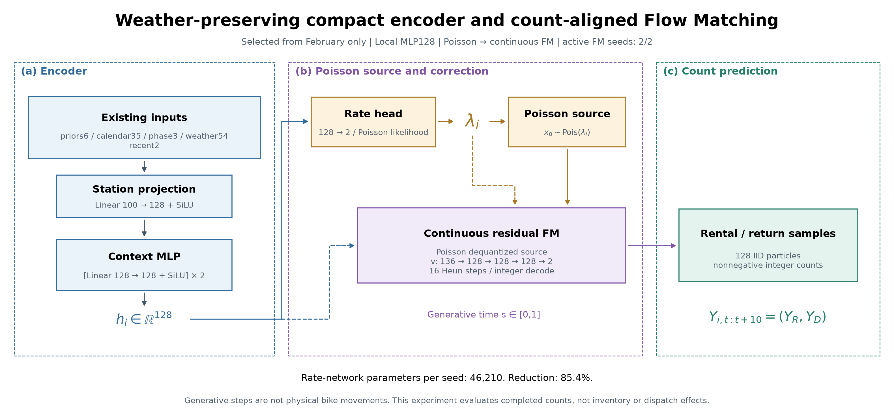

# H-0024: 작은 encoder와 건수 정합 FM

## 가설

기상을 유지한 작은 encoder와 건수 정합 FM이 포아송 단독보다 분포 오차를 1% 이상 줄이는지 검증했다. Encoder는 파라미터를 절반 이상 줄이고 2월 검증 MAE·deviance를 기존 모델의 1% 이내로 유지하는 조건으로 골랐다.

## 실험

dislab RTX 3080에서 encoder 4종×2시드, FM 학습 경로 3종×2시드를 비교했다. Encoder는 2월 전반, decoder는 후반에서 고르고 모두 잠근 뒤 이미 노출된 3월을 평가했다. 평균 건수는 262,144개 대여소·시각, 분포는 같은 표본의 앞 32,768개×128개 입자를 사용했다. API는 열지 않았다.

첫 시도는 필수 인자 누락으로 첫 학습 checkpoint 전에 실패했다. [실패 기록](../research/runs/H-0024-20261110-count-aligned-flow/attempt-01.json)을 보존하고 인자만 수정했다. 성공한 재실험의 연산은 352.1초였다. [실행 manifest](../research/runs/H-0024-20261110-count-aligned-flow/manifest.json), [전체 추적과 지표](../research/runs/H-0024-20261110-count-aligned-flow/summary.json).

## 결과

### Encoder

| 구성 | 시드당 rate 파라미터 | 3월 mean count MAE ↓ | count deviance ↓ |
|---|---:|---:|---:|
| 기존 구조 재학습 | 317,122 | 0.143600 | 0.392816 |
| 선택된 Local MLP128 | 46,210 | 0.144643 | 0.392934 |
| 경량 GCN128 | 47,234 | 0.140990 | 0.398480 |
| 소형 profile MLP128 | 116,674 | 0.144010 | 0.396481 |
| 기존 고정 H13 | 317,122 | 0.143247 | 0.392461 |

선택된 encoder의 rate 파라미터는 **85.43% 감소**했다. 재학습 대조군 대비 3월 MAE는 0.727%, deviance는 0.030% 증가했다. 같은 성능을 증명한 것은 아니다. 경량 GCN은 낮은 MAE를 보였지만 확률 평균 적합도는 나빠졌고, 3월을 본 뒤 최종 후보로 바꾸지 않았다.

### FM

| 같은 작은 encoder의 출력 경로 | count energy ↓ |
|---|---:|
| 포아송 단독 | 0.155172 |
| Gaussian FM·학습 손실 선택 | 0.159281 |
| Gaussian FM·건수 점수 선택 | 0.158938 |
| 포아송 출발 연속 FM·선택 후보 | 0.155111 |
| 정수 count-FM | 0.155055 |

포아송 출발 연속 FM은 같은 encoder의 기존 Gaussian-MSE 방식보다 **2.618% 감소**했다. 다만 포아송 단독 대비 감소는 **0.039%**, 3일·7일 블록 구간은 각각 **[-0.291%,0.284%] /[-0.234%,0.265%]**로 0을 포함했다. 주가설은 **지지하지 않음**이다. 두 시드의 FM은 실제 학습 epoch 20/15가 선택됐으며 무보정 우회가 아니다.

Gaussian FM의 예상 0건 비율은 87.86%, 실제는 91.71%였다. 포아송 출발 FM은 93.00%였다. 출발 분포를 바꿔 큰 오차 증가는 줄였지만 포아송 단독에 추가 이득을 입증하지는 못했다. Gaussian 적분을 16→64단계로 늘린 진단의 energy 변화는 0.154628→0.154491였다. 단계 수는 3월 점수로 다시 선택하지 않았다.

[전체 표·그림·진단](../research/runs/H-0024-20261110-count-aligned-flow/results.md) · [추가 해석과 paired 구간](../research/runs/H-0024-20261110-count-aligned-flow/interpretation.json)

### 모델 파일과 실행

선택한 두 시드 encoder+FM은 **194,056개 파라미터**, 가중치 파일 합계 **791,884바이트**다. 과거 특성 cache는 이 크기에 포함하지 않는다. [모델 카드](../research/runs/H-0024-20261110-count-aligned-flow/model-card.json)와 [ZIP 식별자·해시](../research/runs/H-0024-20261110-count-aligned-flow/model-bundle.json)를 보존했다. 실제 ZIP은 채팅의 작업 결과 파일로 제공하며 가중치를 Git 원문에 넣지 않았다.

ZIP을 dislab에서 풀고 해당 폴더에서 실행한다.

```powershell
python make_demo_features.py
python count_candidate.py --model-dir . --features demo-features.npz --out demo-predictions.npz --device cuda
```

Demo는 합성 입력 8행의 실행 확인이며 실제 수요 예측이 아니다. CPU/CUDA에서 원 연구 구현과 평균·정수 입자가 정확히 같았고, 잘못된 입력 2종을 거부했다. 포장된 CLI도 실제 실행했다. [CPU 검사](../research/runs/H-0024-20261110-count-aligned-flow/portable-cpu-check.json) · [CUDA 검사](../research/runs/H-0024-20261110-count-aligned-flow/portable-cuda-check.json) · [CLI 검사](../research/runs/H-0024-20261110-count-aligned-flow/portable-cli-check.json)

실제 입력은 `own[N,100]`(과거 평균6·달력35·10분 위치3·기상54·최근 자기 흐름2)과 `prior[N,2]`다. 기존 시점 제한·인코딩을 따라 준비해야 한다. 실행 도구가 API나 특징을 자동 수집하지 않는다. 출력은 대여·반납 순서의 `count_samples[N,128,2]`와 `mean_rate[N,2]`다.

### 선택된 구조



### 다음 행동

작은 encoder와 학습한 FM 후보를 보존했다. 가중치를 기존 H13에 덮어쓰거나 관리자 경로를 교체하지 않았다. 이번 점수는 거래 건수이며 재고·0대 대여소 성능이 아니다. 다음에는 특징 추가보다 기존 기상 입력의 운영 가용성, 계절별 시간 분할, 별도 사전 계획의 9월 외부 재고 평가를 확인한다. API로 재학습·선택·보정하지 않는다.

정수 count-FM은 [Wei·Pearson 원문](https://arxiv.org/html/2605.07746v3)의 bridge·rate matching을 조건부 포아송 출발에 적용한 후보다. 최종 선택은 포아송 출발 **연속** FM이므로 이를 정수 count-FM의 우승 결과로 설명하지 않는다.
