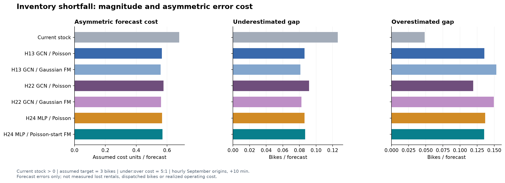
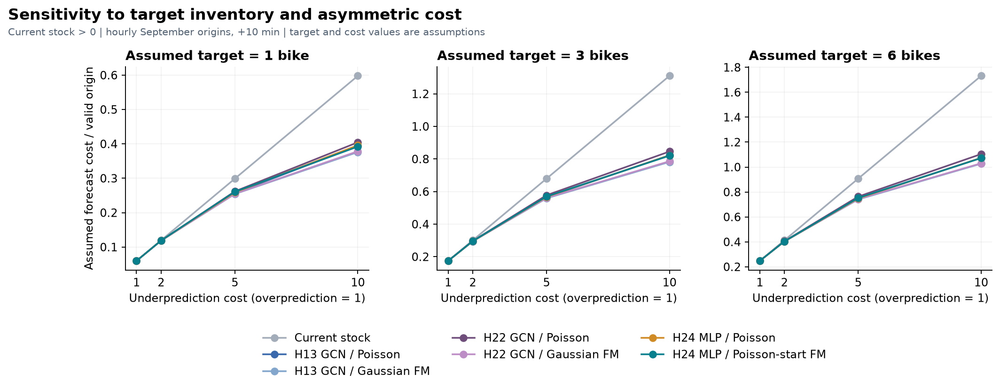

# H-0025: 재고 부족량과 비대칭 비용

## 가설

동결한 H24 FM이 같은 encoder의 포아송보다 현재 양수 대여소의 목표 3대 부족량에 대한 5:1 비대칭 비용을 1% 이상 줄이는지 검증했다. 기존 H24 판정과 가중치는 바꾸지 않았다.

## 실험

dislab에서 고정 모델 7종을 공식 9월 API로 재생했다. KST 정각마다 현재·직전 관측으로 10분 뒤 표시 재고를 예측했다. 누락을 0대로 채우지 않았고 미래 유효성은 발행 뒤 채점에만 사용했다. API로 학습·모형 선택·보정하지 않았다.

유효 409,967쌍, 현재 양수 222,727쌍, 1,298개 대여소, 14일. 수치 실험 566.2초. 전체 H13 평가와 다른 정각 원점 표본이며 9월은 이미 노출된 자료다.

부족량은 `Z=max(0,목표-미래표시재고)`다. 목표 1·3·6대와 부족/과잉 비용 1·2·5·10:1은 운영 미확인 가정이다. 비용 비율에 맞춘 부족량 분위수를 Q로 예측하고 `cu*max(0,Z-Q)+max(0,Q-Z)`를 채점했다. 실제 배차량이나 배차 후 효과가 아니다.

## 결과

주가설 판정: **지지되지 않았다**. H24 FM의 비용은 같은 encoder의 포아송보다 **0.353% 증가했다**.

- 상대 감소율의 3일 블록 95% 구간: [-0.652%, 0.044%]
- 상대 감소율의 7일 블록 95% 구간: [-0.502%, -0.001%]

부족량을 적게 예측한 대수는 포아송보다 많았다. 평가 표본 수·기간 조건은 충족했다.

### 주조건: 현재 양수·목표 3대·부족 비용 5배

| 모델 | 가정 비용 ↓ | 부족량 과소예측, 대 ↓ | 부족량 과대예측, 대 ↓ | 부족량 분포 fairCRPS ↓ |
|---|---:|---:|---:|---:|
| Current stock | 0.679370 | 0.126190 | 0.048418 | 0.174608 |
| H13 GCN / Poisson | 0.565895 | 0.086069 | 0.135547 | 0.147361 |
| H13 GCN / Gaussian FM | 0.558796 | 0.081167 | 0.152963 | 0.147052 |
| H22 GCN / Poisson | 0.577546 | 0.091632 | 0.119384 | 0.148479 |
| H22 GCN / Gaussian FM | 0.561221 | 0.082347 | 0.149483 | 0.147236 |
| H24 MLP / Poisson | 0.567843 | 0.086231 | 0.136688 | 0.147698 |
| H24 MLP / Poisson-start FM | 0.569850 | 0.086900 | 0.135350 | 0.147549 |

### 비용 기준에 따른 차이

| 모델 | 1:1 | 2:1 | 5:1 | 10:1 |
|---|---:|---:|---:|---:|
| Current stock | 0.174608 | 0.300799 | 0.679370 | 1.310322 |
| H13 GCN / Poisson | 0.174622 | 0.294868 | 0.565895 | 0.823106 |
| H13 GCN / Gaussian FM | 0.174860 | 0.294518 | 0.558796 | 0.781989 |
| H22 GCN / Poisson | 0.174761 | 0.296749 | 0.577546 | 0.845919 |
| H22 GCN / Gaussian FM | 0.174703 | 0.295281 | 0.561221 | 0.786196 |
| H24 MLP / Poisson | 0.174725 | 0.295478 | 0.567843 | 0.822514 |
| H24 MLP / Poisson-start FM | 0.174774 | 0.296125 | 0.569850 | 0.820412 |

### 같은 encoder에서 FM 추가 전후: 기술적 점추정

아래는 사전 비교군의 기술적 비교다. H13/H22를 새 확인적 주가설로 바꾸거나 API로 승자를 선택하지 않는다. 양수는 FM 비용 감소, 음수는 증가다.

| 구조 | 비용 1:1에서 FM 비용 감소율 | 비용 5:1에서 FM 비용 감소율 |
|---|---:|---:|
| H13 | -0.136% | 1.254% |
| H22 | 0.033% | 2.827% |
| H24 | -0.028% | -0.353% |

### 현재 재고별 결과

| 현재 상태 | 표본 수 | 유지 비용 | H13 Poisson | H13 FM | H22 Poisson | H22 FM | H24 Poisson | H24 FM |
|---|---:|---:|---:|---:|---:|---:|---:|---:|
| all | 409,967 | 0.403167 | 0.341554 | 0.337698 | 0.347896 | 0.339015 | 0.342637 | 0.343728 |
| current_zero | 187,240 | 0.074615 | 0.074696 | 0.074696 | 0.074722 | 0.074696 | 0.074749 | 0.074749 |
| current_positive | 222,727 | 0.679370 | 0.565895 | 0.558796 | 0.577546 | 0.561221 | 0.567843 | 0.569850 |
| current1_2 | 126,155 | 0.878118 | 0.731465 | 0.721002 | 0.747454 | 0.723642 | 0.734747 | 0.738425 |
| current3plus | 96,572 | 0.419739 | 0.349604 | 0.346902 | 0.355590 | 0.349045 | 0.349812 | 0.349636 |

### 해석 범위와 다음 행동

보조 0대 Brier는 목표 1대 부족량이 재고 0대 지시값과 같다는 관계로 집계값에서 정확히 복원했다. 수작업 예제 검사를 통과했다. 같은 정각 표본의 재고 중앙값 MAE는 초기 집계에서 누락되어 미집계로 남겼다. 기존 전체 표본 MAE를 대신 붙이지 않았다. 부족량 MAE와 주지표는 집계했다.

목표 대비 몇 대가 부족한지를 채점했다. 실제 대여 시도·포기 기록이 없으므로 미충족 수요 인원, 품절 때문에 사라진 거래량, 운영자가 옮긴 뒤의 개선을 측정한 결과로 읽지 않는다. 부족량 분위수는 비용 가정에 맞춘 예측 출력이며 실제 배차 권고량이 아니다.

API 점수로 승자·분포·목표·비용 비율을 다시 고르지 않았다. 순위는 이번 고정 조건의 기술적 비교이며 기본 H13·관리자는 유지한다. 실제 운영 의사결정에는 목표 재고의 근거와 운영 단가, 동일 기간의 거래·재고·개입 로그가 필요하다.

다음 행동은 모델 용량이나 특징을 늘리기보다 재고 목표·부족 비용의 운영 근거와 미충족 수요 관측 가능성을 확인하는 것이다. 새 학습이 필요하면 과거 이력 안에서 별도 가설로 손실을 고정하고, API는 외부 검증으로 유지한다.

[모든 조건 CSV](../research/runs/H-0025-20261110-shortfall-cost/all-conditions.csv) · [전체 결과 JSON](../research/runs/H-0025-20261110-shortfall-cost/results.json) · [완료·재생 순서 검사](../research/runs/H-0025-20261110-shortfall-cost/completion-audit.json)
