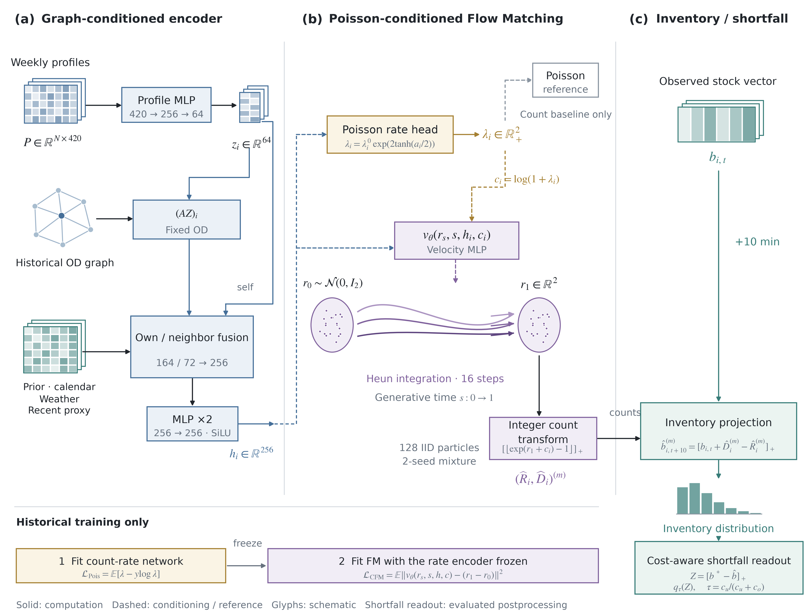
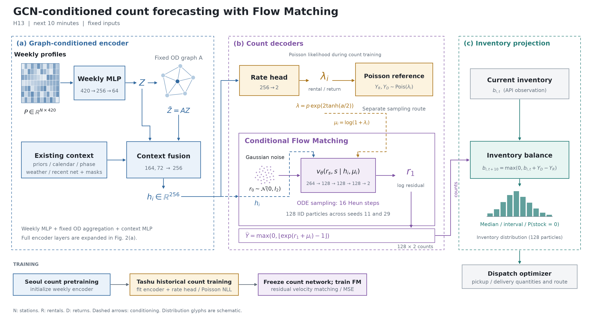
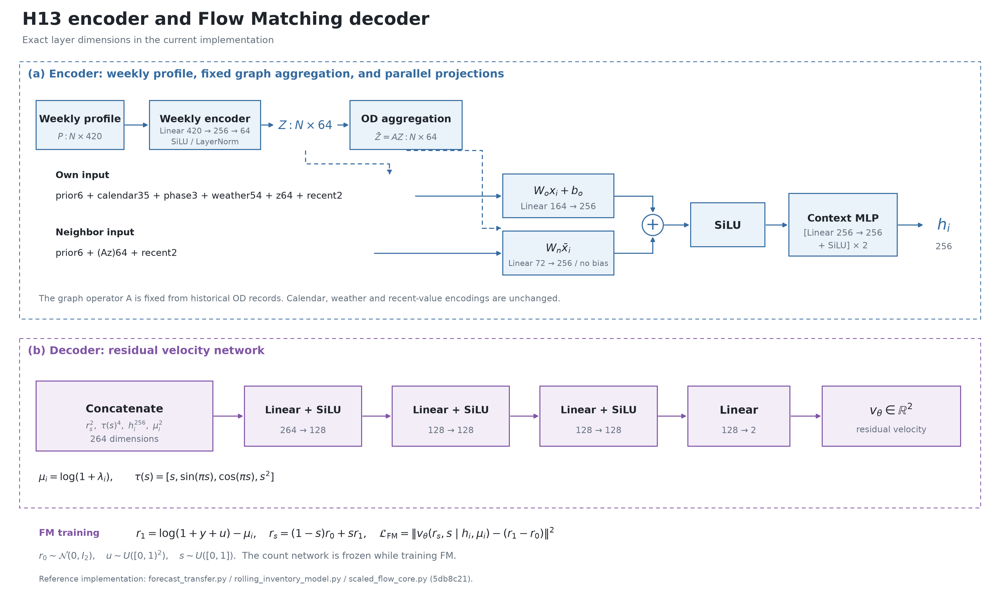

# 최종 모델 구조 그림

현재 최종본은 [Tashu GCN–Flow Matching v1](final-model-v1.md)이다. 전체 구조와 층별 상세를 논문 형식으로 다시 그렸고, 가중치·입력·encoder·decoder를 H13에 고정했다.



[전체 PDF](../assets/tashu-final-framework.pdf) · [층별 PDF](../assets/tashu-final-layers.pdf) · [전체 SVG](../assets/tashu-final-framework.svg) · [층별 SVG](../assets/tashu-final-layers.svg)

아래는 2026-11-09의 이전 그림·설명이다. 과거 기록을 보존한다.

---

# 타슈 아키텍처 그림

현재 H13 구현의 구조를 논문용 그림으로 그렸다. 입력 종류·네트워크·가중치는 변경하지 않았다.

## Figure 1. 전체 예측 경로



[편집 가능한 SVG](../assets/model-architecture-v1.svg) · [벡터 PDF](../assets/model-architecture-v1.pdf) · [고해상도 PNG](../assets/model-architecture-v1.png)

**Caption.** Graph-conditioned count forecasting with conditional Flow Matching. (a) A weekly-profile MLP encodes historical station profiles. A fixed OD operator aggregates neighboring station representations, which are combined with the existing context through parallel own-station and neighbor projections. (b) A Poisson-trained rate head predicts rental and return means. A conditional velocity network uses the shared station representation and log means to generate two-dimensional count residuals from Gaussian noise. The Poisson sampler is a separate reference route. (c) Generated rental and return counts are combined with the current observed stock to obtain the next ten-minute inventory distribution. Dispatch quantities and routes are calculated by a separate optimizer. Dashed arrows indicate conditioning. Tensor and distribution glyphs are schematic, not experimental observations.

파란색은 encoder, 노란색은 평균 head와 포아송 경로, 보라색은 FM decoder, 초록색은 재고 계산이다.

## Figure 2. Encoder·decoder의 층



[편집 가능한 SVG](../assets/model-architecture-layers-v1.svg) · [벡터 PDF](../assets/model-architecture-layers-v1.pdf) · [고해상도 PNG](../assets/model-architecture-layers-v1.png)

**Caption.** Layer dimensions of the H13 encoder and residual velocity decoder. (a) Weekly station profiles are embedded into 64 dimensions. Own-station and neighbor context vectors of 164 and 72 dimensions are projected separately into 256 dimensions, added, and passed through SiLU and two hidden linear layers. (b) The velocity MLP concatenates the 256-dimensional context, two log means, two residual coordinates, and four time features. Three 128-dimensional hidden layers produce a two-dimensional velocity. The count network is frozen during FM training.

## 구현과 대조한 범위

- 수치 구현 기준: `5db8c21c9e9740cd6e8c90b50dd087716c45c861`.
- 상세 입력·손실·H22 비교: [모델 명세](model-architecture-v1.md).
- 이 그림은 H13 기준이다. H22를 H13과 혼합한 새 모델로 그리지 않았다.
- 포아송 표본을 FM의 시작 분포로 연결하지 않았다. 현재 FM의 시작 분포는 독립 Gaussian이다.
- 재배치 차량 동선은 FM의 ODE 적분 경로와 별개다.
- API 재고는 추론의 시작 상태이며, 위 학습 경로의 정답으로 연결하지 않았다.

## 원문과 그림 표현

[Kipf & Welling의 GCN Figure 1](https://arxiv.org/pdf/1609.02907)은 그래프·특징 표현의 경계를, [Flow Matching 원문](https://arxiv.org/html/2210.02747v2)은 잡음·조건부 속도장·생성 결과의 역할을 확인하는 데 참고했다. 위 그림의 층과 연결은 이 저장소 구현에서 확인한 내용이다. 원문의 다층 GCN이나 최적수송 결합을 이 프로젝트에 구현한 것으로 표시하지 않았다.

## 다시 내보내기

선택 도구인 `matplotlib`을 설치한 환경에서 저장소 루트에서 실행한다. 모델·원자료·SSH 없이 그림 파일만 생성한다.

```powershell
python tools/render_architecture_figure.py
```

PNG는 220dpi, PDF는 벡터, SVG는 편집 가능한 텍스트와 도형으로 저장한다. 화면 캡처를 원본으로 사용하지 않는다.
