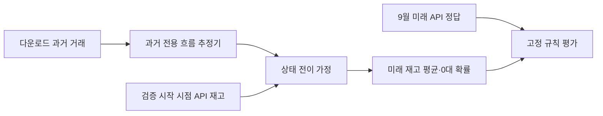

# 아키텍처 아이디어를 실험 질문으로 좁히기

기존 구조의 시간·공간·확률 생성 아이디어는 연구 후보로 가져온다.
학습은 다운로드한 과거 이력, 공식 재고 평가는 [9월 API](september-evaluation-contract.md)라는 경계를 유지한다.
기존 구현·점수나 조합을 완성본으로 승계하지 않는다.

## 1. 가설

큰 질문은 **어떤 시간·공간·확률 표현이 미래 API 재고를 예측하는 데 실제로 필요한가**다.
아래는 후보와 조건이며 최종 조합이 아니다. 한 단계의 실패를 전체 방법군의 기각으로 확대하지 않는다.

| 가져올 아이디어 | 현재 자료에서 맡길 수 있는 역할 | 먼저 답할 질문 |
|---|---|---|
| 시간 변화 | 과거 거래의 달력·계절·수준과 도착/출발 패턴 추정 | 9월에 얻을 수 없는 최근 거래 입력 없이 어떤 정보가 유효한가? |
| GCN·관계 학습 | 과거 전용 OD·거리·학습 관계로 대여/반납 추정의 맥락 구성 | 같은 시간 정보·출력 분포에서 자기 대여소 대비 추가 가치가 있는가? |
| 포아송 사건 과정 | 과거 흐름 추정값을 사건률로 사용하는 단순 재고 전이 가정 | 관측된 완료 거래율을 이런 사건률로 옮기는 근사가 어느 범위에서 실패하는가? |
| 계수형 관측 분포 | 미래 거래 또는 상태의 분산·0·꼬리 표현 | 횟수와 재고를 구분했는가? 학습 정답과 관측 과정에 맞는가? |
| Flow Matching | 여러 대여소·시점의 **거래 흐름** 또는 잠재 혁신을 함께 생성 | 독립 과정·단순 결합 기준선보다 필요한 의존성을 표현하는가? |
| 상태·과정 모듈 | 현재 재고와 미래 흐름을 비음수 미래 상태로 연결 | 초기 상태·경계·재배치·관측 지연을 어떻게 가정하고 평가하는가? |

자료 제약 때문에 분리해야 할 선택이 있다.
과거 기록에는 거래 정답이 있고 실측 재고 정답은 없다. 따라서 API 미래 재고를 학습 정답으로 사용하거나,
9월에 없는 최근 거래를 0으로 채우는 설계를 채택하지 않는다.
직접 상태 학습·잠재 상태 학습·거래 생성 후 상태 전이를 모두 같은 문제라고 부르지 않는다.

## 2. 실험

### 선행연구에서 옮길 부분과 옮길 수 없는 부분

- [Gast 외, 2015 §2.2~3.1](https://www.pure.ed.ac.uk/ws/portalfiles/portal/23608488/Gast_et_al_2015_Probablistic_Forecasts.pdf):
  대여/반납의 사건 과정과 현재 상태를 이용하는 큐 예측을 확인했다. 원문의 발생률 추정은 비어 있지 않거나 가득 차지 않은 시간에 대한 정보가 필요하다.
  우리 과거 이력에는 그 실측 재고가 없으므로 같은 발생률 추정을 재현했다고 주장할 수 없다. 완료 거래율을 쓰는 근사는 별도 검증 대상이다.
- [Lin 외, 2018 §3·§4](https://arxiv.org/pdf/1712.04997): 거리·이동·기간·학습 관계를 구분하고 관계 행렬을 학습 기간에서 만든다.
  우리도 관계 정의를 비교하되 과거 거래 입력을 9월에 관측할 수 있다고 가정하지 않는다.
- [Lipman 외, 2023 §2~3](https://arxiv.org/html/2210.02747v2): FM은 분포 경로의 벡터장을 학습한다.
  생성 시간은 자전거 이동 시간이 아니다. 과거 거래 벡터의 생성과 실제 재고 전이를 분리할 후보 근거다.
- [Gat 외, 2024 §2](https://arxiv.org/html/2407.15595v2): 유한 이산 상태 공간의 생성은 연속 변환과 다른 선택지다.
  순서·대수 범위·큰 건수의 처리와 계산 비용은 우리 문제에서 별도 검토한다. 언어 실험 성능을 타슈 근거로 승계하지 않는다.

### 첫 비교: H-0005

먼저 [H-0005](H-0005-history-to-stock.md)에서 기존에 학습해 고정한 **과거 거래율→재고 전이** 연결을 평가한다.
현재 API 재고는 검증 시작 상태로만 사용하고 미래 API 관측은 정답으로만 사용한다.
GCN·FM·API 보정은 붙이지 않는다. 이때 단순 모형은 최종 아키텍처가 아니라 후속 모듈을 비교할 기준점이다.

### 이후 질문은 축별로 분리

| 순서 | 바꿀 축 | 유지할 대조 조건 | 설계가 더 필요한 부분 |
|---|---|---|---|
| 첫 연결 | 흐름→상태의 단순 확률 과정 | 고정된 과거 흐름·동일 9월 입력/정답 | H-0005에 동결 |
| 공간 정보 | 흐름 추정기의 GCN/관계 정보 | 같은 과거 학습 범위·시간 정보·상태 모듈·출력 | 과거 전용 그래프·자기 이력/치환 관계 대조·학습 예산 |
| 분포 표현 | 독립 사건과 분산·0·꼬리가 유연한 흐름 | 같은 학습 자료·인코더·공식 평가 | 과거 기록의 사건 분포 가정과 학습 손실 |
| 결합 생성 | 단순 결합 대비 FM·다른 생성 방식 | 가능한 한 같은 맥락·상태 전이·계산 예산 | 필요 의존성·정수 표현·조건부 prior·결합 평가 |

위 순서는 연구 질문을 분리하기 위한 것이며 번호가 있는 후속 가설은 아직 동결하지 않았다.
9월 점수에 맞춰 하이퍼파라미터·보정·구조를 반복 선택하지 않는다.
같은 9월을 반복 보고할 때는 사전 노출·실험 횟수와 고정 계획을 함께 남긴다.

## 3. 결과

이 문서 자체의 실증 결과는 없다. H-0004의 건수 점수를 재고 성능으로 대체하지 않는다.
구체적으로 좁힌 첫 질문은 H-0005이며, 그 결과·한계는 별도 보고서에 기록한다.
각 구성요소가 무엇을 추가하는지 확인한 뒤 아키텍처를 구체화하며 GCN+FM+포아송을 필수 조합으로 확정하지 않는다.
