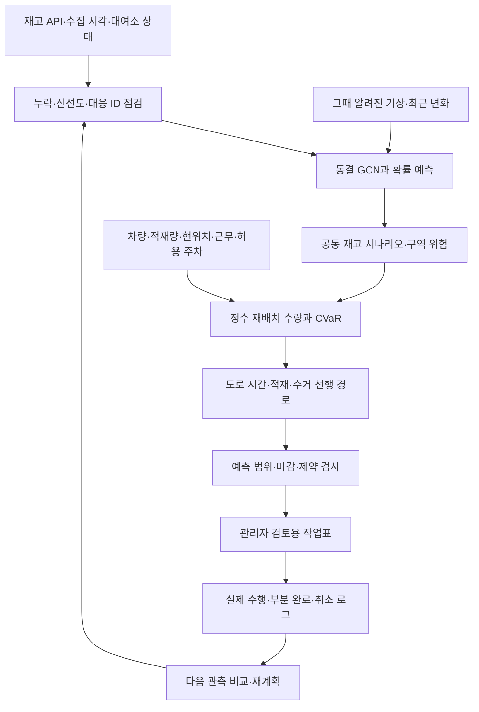

# 예측부터 재배치 수량·차량 동선까지

작성일:2026-11-01 KST. **실제 운영 효과 검증 전인 연구·그림자계획 시제품**이다.
현재 검증 범위를 먼저 구분한다: H13은10분 실제 API 예측/관측 연결, [H14/PR21](https://github.com/sijoon-sung/KT-X-AI-/pull/21)은 공동 예측 성능 연구,
H15/PR22는 그 시나리오를 소비하는 수량·적재·동선 인터페이스의 합성 기능 검증이다.

## 가설

관리자 시스템은 “어디가 부족한가”에서 “어디에서 몇 대를 가져와 어디에 배치하고 어떤 순서로 방문하는가”까지 연결되어야 한다.
예측 모형의 좋은 점수와 현실의 이동 비용·서비스 개선은 각각 검증한다.
이 시제품은 주어진 시나리오·운영제약 아래 일관된 수량과 실행 가능한 작은 경로를 산출할 수 있는지 검사한다.

평균 부족량의 기대 합만 최소화하면 각 대여소의 주변분포가 같을 때 공동 연결은 결정에 영향을 주지 않는다.
따라서 **전체 부족이 겹치는 나쁜 상황의 꼬리위험(CVaR)**을 목적함수에 포함한다.
이 연결이 FM 공동 시나리오의 잠재 가치를 결정 단계에서 검증하는 통로다. FM이 그 관계를 실제로 잘 학습했는지는 H14의 별도 결과다.

## 실험과 전체 파이프라인



### 1. 관측·모형 입력을 준비한다

API표시재고·관측시각·정상 자전거·대여소 운영 여부를 구분한다. 누락을0대로 만들지 않는다.
검증된 모델-lock과 관측 버전으로 예측을 발행하고, 과거/현재 입력과 미래 정답을 분리해 저장한다.
API를 모델 학습·보정·승자 선택에 재사용하지 않는다. 현재 실시간 기상 수신은 별도 구현·검증 과제다.

수집기와 같은 기준 시계로 입력 나이/발행기한을 검사한다. dislab OS 시계를 무조건 동기화된 것으로 가정하지 않는다.
계획기는 trusted adapter가 확인한 관측/가중치 정보를 소비한다. SHA 문자열 형식 검사만으로 실제 파일 진본성이 입증되는 것은 아니다.
이번 합성검사에서 실제 API 수집·lock adapter·도로 API를 실행한 것으로 주장하지 않는다.

### 2. 예측을 관리자의 의사결정 단위로 바꾼다

입력 계약은 `station_ids × stock_scenarios`, `forecast_target`, `supported_horizons`, `model_lock`다.
각 대여소 p0/범위와 함께 구역의0대 대여소 수·90/95% 위험상한·동시 부족을 계산한다.
현재0대와 미래에 부족해질 곳을 구분하고, 자전거를 가져가도 되는 공급 대여소의 남을 재고도 함께 본다.

과거 OD 그래프는 수요/의존성 맥락이다. 차량이 주행할 도로 그래프·이동시간 행렬과 같은 것이 아니다.
FM의 flow-time도 자전거 운행 시간이나 실제 이동 경로가 아니다.

### 3. 어디에서 몇 대를 옮길지 계산한다

운영자 입력으로 대여소별 목표 buffer `b_i`, 수거/배치 허용상한, 차량/작업량 한도를 받는다.
공급 후보는 현재 재고·낮은 예측 quantile의 buffer 여유·입력된 수거상한으로 제한하고, 제공된 모든 terminal 시나리오에서 음수가 되지 않게 한다.
배치 후보는 buffer 부족과 운영자가 확인한 배치 허용상한으로 제한한다. API대수를 주차공간 상한으로 추정하지 않는다.

정수 `x_ij`는 i에서 j로 옮길 대수다. 출발·도착 합과 차량 내 재고가 보존되어야 한다.
시나리오 m의 대여소 buffer 부족 `l_i^m=max(0,b_i−(S_i^m+net_i))`, 전체 `L_m=sum_i w_i*l_i^m`를 사용한다.

`목적 = mean(L) + lambda*CVaR_alpha(L) + 이동시간 기반 수량 비용대리 + 처리 비용`.

CVaR는 `eta + mean(max(L−eta,0))/(1−alpha)`의 선형 보조변수 형태로 계산한다.
이 식은 [Rockafellar·Uryasev 원문](https://sites.math.washington.edu/~rtr/papers/rtr179-CVaR1.pdf)의 시나리오 방법을 참고했다.
여기서 L은 **주어진 terminal 시나리오의 buffer 부족 대리 손실**이다. 미충족 실제 대여 수요나 실측 경제 손실이 아니다.
lambda·buffer·위험수준은 운영 목적의 입력이며 9월 API오차로 선택하지 않는다.

### 4. 수량과 동선을 다시 맞춘다

수량 배정 후 방향 있는 도로 시간 행렬로 방문 순서를 구한다. 같은 차량의 수거가 해당 배치보다 앞서야 하고,
각 방문 후 적재는0~차량 적재량, 복귀까지 이동+작업시간은 계획 마감 안에 있어야 한다.
수량은 가능해도 경로가 불가능하면 작업량을 줄여 재배정한다. 버린 안과 남은 부족을 함께 남긴다.

H15 구현은 **1차량·대여소당1방문·최대8stop**에 대해 수량MILP와 작은 경로의 정확한 순열 탐색을 연결했다.
수량과 경로를 합친 전역 최적해라고 주장하지 않는다. 작업량 축소는 보수적인2단계 heuristic이며 같은 작업량의 다른 배정을 놓칠 수 있다.
생산 규모에서는 권역·후보 제한/수량 master와 다차량 pickup-delivery VRP를 연결하고 비용·적재·shift 제약을 검증한다.
[공유재고와 경로를 결합한 선행연구](https://www.andrew.cmu.edu/user/vanhoeve/papers/bike_sharing.pdf) 및
[OR-Tools의 같은차량/수거선행 제약](https://developers.google.com/optimization/routing/pickup_delivery)을 참고하되 전체 재현으로 부르지 않는다.

[OSRM Table](https://project-osrm.org/docs/v5.24.0/api/) 등 도로서비스는 방향 있는 시간 행렬을 공급하는 별도 adapter다.
car 프로필을 실제 재배치 차량의 높이·중량·진입 제한을 검증한 경로로 바꾸어 보고하지 않는다.
이번 시험의 도로시간은 합성이며 실제 교통·주행속도·법적 진입 가능성을 확보한 결과가 아니다.

### 5. 시간 범위를 맞추고 이중 반영을 막는다

현재 예측 검증 범위는10분이다. H15는 **10분 terminal 목표 시각 전까지 모든 이동을 마치는 정적 그림자계획**이다.
방문시각2분/4분의 재고를10분 예측으로 검증했다고 하지 않는다. 수거 시점 실제 재고는 현장/새관측으로 다시 확인해야 한다.
실제30~60분 경로를 권고하려면 해당 도착시간의 예측과 시간 경로·행동 반응을 별도 가설로 검증해야 한다.
30분 모델이 없는 상태에서10분 예측을 반복 덧셈해 검증된 미래 재고로 사용하지 않는다.

이미 완료된 이동은 새로운 API 시작 상태에 반영돼 있으므로 다시 더하지 않는다.
작업ID·실행시각·관측버전으로 완료/예약/미완료를 분리하고, 진행 중 작업은 다음 계획에서 잠근다.
이 모델은 조치 후 수요·반납이 그대로라는 근사를 사용한다. 실제 행동에 반응하는 수요·가용성 simulator를 검증한 것이 아니다.

### 6. 작업표·실행 로그·검증으로 닫는다

관리자는 `출발→도착`, `수거/배치 대수`, `방문 순서`, `예상 도착·완료`, `각 stop 적재`, `미처리 부족`, `자료 나이/가정`을 본다.
현장 수행은 정상/고장 자전거·허용 주차를 확인하고 실제 수량·시각·취소 이유를 기록해야 한다.
새 관측 때 현 재고·차량 적재/위치·실행 완료를 반영해 재계획한다. 모델 가중치는 API로 갱신하지 않는다.
이 코드의 출력은 항상 `dispatch_allowed=false`이며 실제 지시·메시지·차량 이동은 실행하지 않는다.

| 현재 수준 | 검증된 것 | 남은 것 |
|---|---|---|
| 재고 예측 연결 | H13 실제10분 API 발행/다음관측 채점 | 현장 재고·정상 자전거·실시간 기상 수신 |
| 공동 예측 | H14 별도 학습/선택/gate | 새 공동위험 성능은 H14결과로 판단 |
| 수량/경로 시제품 | H15 합성13개 기능검사 | 실제 자원·도로·작업시간·다차량·긴 예측시간 |
| 운영효과 | 미실행 | 행동/비용/결과 로그와 비교 설계 |
| RL | 미학습 | 검증된 전이·제약·보상·자료계약. 우선 최적화 기준선을 확보 |

## 결과

### 합성 수량·경로의 실행 결과

dislab CPU에서 **검사13개·제약위반0개**, 0.202초다.
이 결과의 `supported`는 정해진 **합성 기능 인수 가설**에 한정한다. 예측 개선·실제 운영 절감·실제 배차 성공이 아니다.
수량 solver는 [고정 SciPy1.15.3 MILP](https://docs.scipy.org/doc/scipy-1.15.3/reference/generated/scipy.optimize.milp.html)를 사용했다.

**아래 A/B/C/D·거점·차량·작업시간·도로시간은 모두 가상**이다. 실제 타슈 배치 권고가 아니다.
차량 적재6대·계획창10분·가상 작업시간0.1분/대의 고정 사례다.

| 순서 | 가상 장소 | 작업 | 도착(분) | 작업 후 적재 |
|---|---|---|---:|---:|
| 1 | A | 수거 6대 | 1.0 | 6대 |
| 2 | C | 배치 5대 | 2.6 | 1대 |
| 3 | B | 수거 4대 | 4.1 | 5대 |
| 4 | D | 배치 5대 | 5.5 | 0대 |

경로는 **거점→A→C→B→D→거점**, 총10대를 옮기며 최대 적재6대, 복귀7.0분이다.
A의 수거6대 뒤 가상 terminal 최소재고6대, B의 수거4대 뒤 최소재고4대를 남기는 입력 buffer 조건을 지킨다.
차량 하나가 한 번에10대를 싣는 계획이 아니다. 가상 입력 밖의 실제 안전 재고·주차 상한은 알 수 없다.

### 공동 시나리오가 결정에 들어가는지 확인한 결과

개별 대여소별 표본을 똑같이 유지하고 연결만 다르게 만든 두 합성 사례에서,
CVaR 수량계획의 목적지는 **A→C로 달라졌다**. 평균 손실만 쓰는 대조는 양쪽 모두A였다.
이는 공동위험이 의사결정 경로에 연결됐다는 기능 증거다. FM이 실제 타슈에서 이 의존성을 정확히 학습했다는 결과는 아니다.

용량 부족·마감1분·도로 불통에서는 무리한 수량을 출력하지 않고 축소/무작업으로 처리했다.
용량 미확인·지원 밖30분 예측·비유한 예측·알 수 없는 lineage·오래되거나 미래인 시각은 거부했다.
원격 시계 지연을 고려해 live-shadow의 신선도 검사는 수집기 기준시각을 요구한다. 실제 adapter의 파일 진본성 확인은 후속 통합 항목이다.
첫10검사는 통과했고 시각 guard를 보완한 뒤 추가3검사와 전체13검사를 다시 통과했다. 수량/경로 결과를 바꿔 좋은 결과를 고른 것이 아니다.

### 다음 구현 순서

1. 실제 운영자가 확인한 차량·현위치/거점·적재량·작업시간·허용상한을 입력받는 adapter를 채운다. 보험대상14대를 실가동 차량으로 넣지 않는다.
2. 검증된 예측 artifact를 표준시나리오 입력으로 연결하고 신선도·지원시간·lock·ID를 확인한다. 실시간 수집기/기상/도로 adapter 인수검사를 분리한다.
3. 30/60분 예측·행동 후 전이를 별도 검증한 뒤 긴 경로/다차량 솔버를 적용한다.
4. 그림자계획과 기존 운영을 같은 자원 아래 비교하는 관측·실행 로그를 확보한다. 가상 정책의 결과를 기존 API의 실제 정답으로 채점하지 않는다.

[H15 실행 manifest](../research/runs/H-0015-20261101-rebalancing-pipeline/manifest.json),
[전체 합성 출력·검사](../research/runs/H-0015-20261101-rebalancing-pipeline/summary.json)를 공개한다. PR은 병합하지 않는다.

```text
python research_code/rebalancing_pipeline.py --request PRIVATE_VERIFIED_SCENARIO_AND_RESOURCES.json --out PRIVATE_SHADOW_PLAN.json
python research_code/rebalancing_acceptance.py --out PRIVATE_ACCEPTANCE --collector-start COLLECTOR_UTC
```
