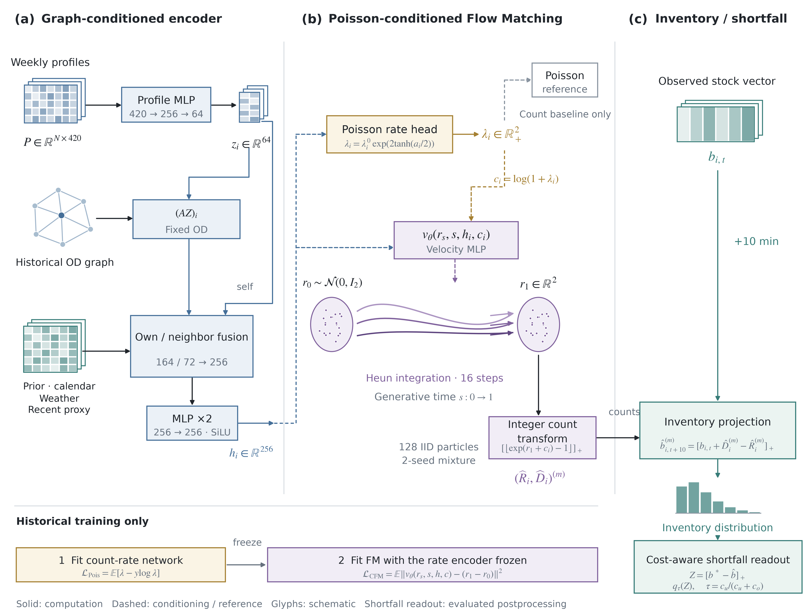
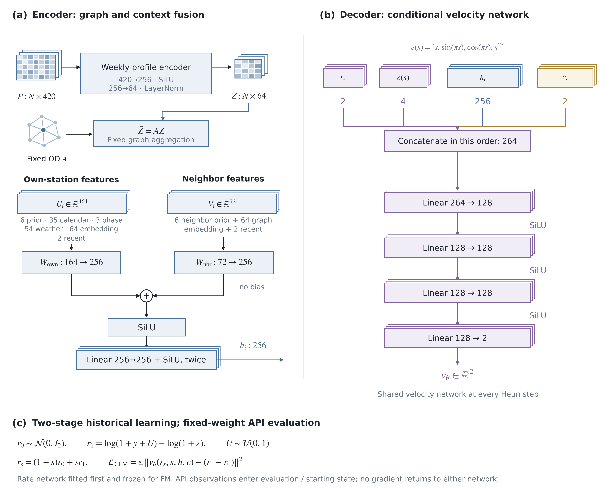

# 최종 모델: Tashu GCN–Flow Matching v1

## 가설과 확정 범위

프로젝트의 최종 backbone은 **기존 H13 recent-GCN + 조건부 Flow Matching**으로 고정했다. 사용자 요구인 GCN·FM을 유지하고, 이미 연결한 예측 경로와 과거 이력에서 잠근 가중치를 사용한다. H22 대형 모델과 H24 경량 모델은 비교 기록으로 남긴다. 9월 평가 순위로 모델·가중치를 새로 고른 결정이 아니다. 모든 모델 중 정확도가 가장 높다는 주장도 하지 않는다.

[기계 판독 명세](final-model-v1.json) · [가중치·차원·반복 추론 검사](final-model-verification-20261110.json)

## 실험과 구현 확인

새 학습은 하지 않았다. dislab에서 원래 H13 잠금 파일과 가중치 해시를 다시 확인하고, 합성 대여소 5개의 실제 GPU 추론을 두 번 실행했다. 출력은 동일했고 비음수 정수였다. encoder 조건은 5×256, rate head와 속도장은 각각 5×2, 재고 표본은 5×128이었다. 원래 H13 학습의 실행 이력은 [H13 기록](H-0013-rolling-api-flow.md)에 보존한다.

| 고정 부분 | 명세 |
|---|---|
| 주간 표현 | 420→256→64, SiLU·LayerNorm |
| 그래프 | 과거 OD 관계의 고정 집계 A·Z, 한 번 |
| 조건 encoder | 자기 164·이웃 72를 각각 256으로 투영해 합산, SiLU, 256 선형층 2개 |
| 포아송 평균 head | 256→2, 대여·반납 평균 λ; Poisson NLL 학습 |
| FM decoder | [잔차2·생성시간4·조건256·로그평균2] = 264→128→128→128→2 |
| FM 시작 분포 | **Gaussian N(0,I₂)**. 포아송 표본에서 시작하는 H24와 다름 |
| 생성 | Heun 16단계, 정수 대여·반납 128표본, 두 시드를 입자마다 독립 선택 |
| 재고 | 현재 재고 + 생성 반납 − 생성 대여, 하한 0 |
| 학습 순서 | 과거 완료 거래로 평균망 학습·고정, 그 다음 FM 학습·고정 |
| 크기 | 활성 두 시드 768,648개 파라미터, 가중치 파일 3,091,418바이트 |

가중치 크기에는 정적 과거 특징 cache가 포함되지 않는다. 실행 ZIP에는 cache와 비교 경로도 들어 있어 전체 크기가 더 크다. [기존 실행 릴리즈](https://github.com/sijoon-sung/KT-X-AI-/releases/tag/h13-runtime-v1.0.1)를 사용한다. 압축을 푼 폴더의 실행법은 [빠른 시작](quickstart.md)을 따른다.

## 결과: 최종 구조 그림

**Figure 1. Graph-conditioned probabilistic forecasting with an asymmetric shortfall readout.** (a) A weekly-profile MLP and a single fixed OD aggregation form station conditions. Existing own-station and neighbor context are projected and fused into a 256-dimensional condition. (b) A Poisson-trained mean head conditions a Gaussian residual Flow Matching decoder. Its Poisson sampler remains a parallel reference, not the FM source. Sixteen Heun steps produce 128 IID rental/return count particles from a two-seed mixture. (c) Current observed stock and count particles define the next-ten-minute inventory distribution. The evaluated decision readout transforms these particles into gaps to an operator-specified inventory target and returns a cost-dependent quantile. R denotes rentals and D denotes drop-offs. Glyphs and paths are schematic, not fitted distributions or physical bicycle routes.

[벡터 PDF](../assets/tashu-final-framework.pdf) · [편집 가능한 SVG](../assets/tashu-final-framework.svg) · [600dpi PNG](../assets/tashu-final-framework.png)

**Figure 2. Exact encoder and velocity-network dimensions.** (a) The weekly encoder maps 420→256→64 with SiLU and LayerNorm. Own and neighbor features have widths 164 and 72. Separate projections into 256 dimensions are added, followed by SiLU and two 256-dimensional hidden layers. (b) The velocity network concatenates two residual coordinates, four time features, 256 condition features and two log means, then applies three 128-dimensional hidden layers with SiLU and a two-dimensional linear output. (c) The count-rate network is fitted first and frozen during conditional velocity regression. API observations do not update either network.

[벡터 PDF](../assets/tashu-final-layers.pdf) · [편집 가능한 SVG](../assets/tashu-final-layers.svg) · [600dpi PNG](../assets/tashu-final-layers.png)

## 부족 비용의 역할

최종 신경망은 재고 분포를 출력한다. 부족을 놓치는 비용은 신경망에 새 head를 붙이는 대신 분포를 읽는 단계에서 반영한다. 목표 재고 b*에 대해 Z=max(0,b*−재고)로 부족량 표본을 만들고, 부족 비용 cu·과잉 예측 비용 co에 맞춰 τ=cu/(cu+co) 분위수를 사용한다. 부족 비용이 클수록 더 높은 부족량 분위수를 읽는다.

목표 3대·비용 5:1은 설명용 조건이다. 실제 적정 재고·단가를 확인한 값이 아니며 API로 이 값을 골라내지 않는다. 이 후처리는 [H25/PR37](https://github.com/sijoon-sung/KT-X-AI-/pull/37)에서 고정 모델로 평가한 부분이다. 현재 관리자 계산기를 새 규칙으로 교체하거나 실제 배차를 수행하지 않았다. 과거 거래에 기록되지 않은 대여 포기 인원, 운영 이동, 도로 동선, 배차 효과를 FM이 복원한 것으로 설명하지 않는다.

## 논문에서 참고한 그림 구성

- [Kipf & Welling, GCN, Figure 1, PDF p.4](https://arxiv.org/pdf/1609.02907): 그래프 노드·특징 행렬·표현 층을 구분하는 도형 문법. 원문 그림은 직접 렌더링해 확인했다. 원문의 다층 정규화 GCN 전체를 구현했다고 주장하지 않는다.
- [Wu et al., Graph WaveNet, Figure 3, PDF p.4](https://arxiv.org/pdf/1906.00121): 모듈별 정렬·분기·합산·반복 층의 연결 표현. 원문 그림을 직접 렌더링해 확인했다. adaptive adjacency·TCN·게이팅은 이 모델에 추가하지 않았다.
- [Lipman et al., Flow Matching, §3–4](https://arxiv.org/html/2210.02747v2): 생성 시간, 조건부 벡터장 회귀, 잡음·목표 경로의 역할. 우리 구조를 OT coupling이나 도시 전체 공동 경로 생성으로 표시하지 않았다.

새 그림은 현재 코드에 맞춰 직접 그린 벡터 원본이다. 모든 그림·PDF 렌더링은 dislab에서 수행했고, PDF를 Poppler로 다시 렌더링해 텍스트·화살표·글꼴·여백을 확인했다. [이전 H13/H22 명세](model-architecture-v1.md)는 비교 이력으로 보존한다.

다음 작업은 이 모델을 기준으로 발표·실행 문서를 유지하는 것이다. 새 모델·입력·학습 손실 변경은 별도 동결 가설로 분리한다.
