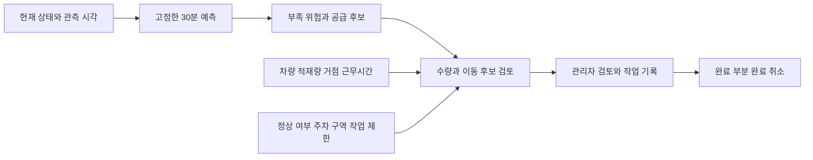

# 타슈 관리자 재배치 시스템 기획

기준일: 2026-10-31. 관리자가 **부족해질 대여소와 가져와도 되는 대여소를 함께 보고, 가능한 작업을 선택하는 시스템**을 목표로 한다.
현재 구현은 [30분 예측 시제품](prediction-system.md)까지다. 아래 관리자 화면·수량 추천·배차는 후속 개발 계획이다.
이번 변경은 공개 운영 자료 조사와 요구사항 정리이며 새 모델 실험이나 현장 재배치 성과를 보고하지 않는다.

## 가설

### 관리자에게 필요한 판단

검증할 질문은 “같은 차량·작업시간 아래, 현재 대수만 보고 옮기는 방법보다 예측 불확실성을 이용한 재배치가 더 도움이 되는가”다.
예측 오차 감소와 운영 개선은 별도다. 먼저 현재 모형을 고정한 채 필요한 출력과 제약을 정하고,
기능 검증과 운영 비교를 각각 별도 가설 PR에서 동결한다. 이 문서는 실험 사전등록을 대신하지 않는다.

관리자는 다음 순서로 판단한다.

1. 유효한 관측이 있는 곳 중 30분 뒤 0대가 될 위험이 큰 곳을 찾는다.
2. 자전거를 가져오면 출발 대여소의 위험이 얼마나 커지는지도 함께 본다.
3. 도착 전까지 가능한 이동인지, 적재량·근무시간·주차 공간을 만족하는지 확인한다.
4. 정상 자전거 이동, 고장 회수, 현장 정리를 구분해 담당 작업자에게 전달한다.
5. 완료·부분 완료·취소와 실제 수량을 기록하고 다음 계획을 갱신한다.

### 뉴스와 정책에서 확인한 운영 근거

| 자료와 기준 시점 | 확인한 사실 | 설계에 반영할 내용과 한계 |
|---|---|---|
| [대전시 보행자전거과, 2024-05-28](https://daejeon.go.kr/drh/drhStoryDaejeonView.do?boardId=blog_0001&menuSeq=1626&ntatcSeq=1457244726&pageIndex=1) | 2024-05-20 권역별 정비센터 4곳 개소. 기존 외삼동 집중 정비를 분산 | 정비 거점과 재배치 출발 거점을 구분. 2026년 현재 주소·운영시간·차량 배속은 별도 확인 대상 |
| 같은 대전시 발표 | 2026년까지 자전거 7,500대·대여소 1,500개소 확대, 2027년까지 인력 충원 계획 | 발표 당시의 목표다. 2026년 실제 규모·현재 가동 차량으로 확정하지 않음 |
| [프레시안, 2024-07-24](https://www.pressian.com/pages/articles/2024072414475724512) | 교통공사·행정안전부·대전시가 약 700만 이용 기록으로 배치 수량과 차량별 대여소 관리그룹 분석 모델을 개발했다고 보도 | AI 재배치 자체를 새 아이디어로 주장하지 않음. 기존 사업의 수량·권역 구분과 비교할 실무 출력 필요. 원 모델·운영 로그·검증 설계 미확보 |
| [KBS, 2026-05-11](https://v.daum.net/v/2hVug071lc) | 출근 뒤 정부대전청사 주변에 100대 이상이 모인 반면, 다른 취재 대여소에는 1대가 남은 상황 보도 | 부족과 집중을 같은 시점에 보여줄 필요. 차량 2부제 관련 보도를 인과 효과의 확정 근거나 현재 계속 적용 중인 정책으로 확대하지 않음 |
| [2026-07-14 보험 재공고 재게시본](https://www.bidpro.co.kr/n0_ipchal/konggo/svc/konggo_view.asp?num=3145967), R26BK01632081-000 | 타슈 사업용 차량 보험 가입 대상 14대. 예정 보험 기간 2026-07-31~2027-07-31 | **보험 대상 전체**다. 재배치 전용·동시 가동 차량 수와 자전거 적재량은 알 수 없음. 원문 첨부 대조 전 잠정 근거로만 보존 |
| [타슈 공식 이용 안내와 약관](https://bike.tashu.or.kr/main.do), 2026-10-31 확인 | 지정 대여소 이용·반납, 잠금 뒤 반납 완료 메시지 확인 안내. 대여소 외 임의 반납 금지 | API 표시 대수를 실제 이용 가능 대수나 빈 거치대 수로 바꾸지 않음. 안내의 1대용·5대용 거치대 예시는 대여소별 허용 수용량이 아님 |

보험 공고는 [2026-07-08 신규공고](https://sujubut.com/bid/domestic/30910/)에서도 찾았다.
[나라장터 원문 및 첨부](https://www.g2b.go.kr/link/PNPE027_01/single/?bidPbancNo=R26BK01622111&bidPbancOrd=000)는
확인 시 2026-10-30 19:00~11-01 24:00 시스템 점검 안내로 연결돼 과업지시서·차량 목록을 읽지 못했다.
보험 대상 14대를 관리자 설정의 실제 가동 차량 기본값으로 넣지 않는다.

2024년 AI 기사에 실린 개선율은 원 수치와 설명이 일치하지 않아 성과 목표로 사용하지 않는다.

### 선행연구와 현재 아키텍처의 역할

[Schuijbroek·Hampshire·van Hoeve 저자 원고](https://www.andrew.cmu.edu/user/vanhoeve/papers/bike_sharing.pdf)는
대여소별 서비스 수준에 필요한 재고와 차량 경로를 연결한다. 공개 원고의 초록·서론에서 재고 목표와 이동 비용의 결합,
구역을 먼저 정하고 경로를 구하는 접근을 확인했다. 논문의 유한 거치대 가정을 타슈에 그대로 적용하지 않는다.
[Gammelli 외](https://arxiv.org/abs/2108.00858)는 예측 정확도 개선이 더 나은 재고 결정으로 항상 이어지지는 않음을 다룬다.
이번에는 공개 초록을 재확인했으며 두 논문의 타슈 운영 성능을 재현하지 않았다.

| 구성요소 | 관리자 시스템에서의 역할 | 현재 구현 범위 |
|---|---|---|
| GCN | 과거 OD 관계를 이용해 대여·반납 흐름 추정 | 차량 도로망·작업 경로가 아님. H7의 성능 우위 가설은 지지하지 않음 |
| Poisson 흐름과 상태 연결 | 현재 표시 재고에서 30분 뒤 분포를 만드는 비교 경로 | 완료 거래율을 잠재 수요율로 식별하지 못하고 실측 주차 상한이 없음 |
| GCN 조건부 Flow Matching | 대여소별 대여·반납 두 건수의 다양한 표본 생성 | H9은 도시 전체의 동시 시나리오가 아님. 같은 표본 번호를 붙인다고 대여소 간 결합 분포가 생기지 않음 |
| 따릉이 특성 | 서울 과거 이용의 달력 패턴을 대전 흐름 예측에 참고 | 2017~18년 도시 집계 특성. 대전의 현재 정책·날씨·행사 충격 관측을 대신하지 못함 |
| 재배치 의사결정 모듈 | 공급 후보·수량·자원 제약·작업 순서를 연결 | 미구현. H9 가중치나 9월 API 점수로 재배치 임계값을 선택하지 않음 |

H9의 규모 확대·서울 특성·FM 융합 개선 가설은 `not_supported`다.
관리자 기능을 추가해도 [기존 결과](H-0009-scaled-seoul-flow.md)는 바뀌지 않으며,
기존 시제품의 연구 모델을 연결하는 것과 운영 모델 채택을 구분한다.

## 실험

### 첫 관리자 화면의 범위

아래는 구현할 화면 구조다. 현재 화면이 이 기능을 제공한다는 뜻은 아니다.

| 화면 | 보여줄 항목 | 자료가 없을 때의 동작 |
|---|---|---|
| 운영 현황 | 관측 기준시각·마지막 갱신·지원 대여소 수·누락·모델 버전·30분 예측 범위 | 누락을 0대로 채우지 않고 관측 미확인으로 표시 |
| 대여소 지도와 목록 | 현재 표시 대수, 30분 뒤 중앙값·범위·0대 확률, 지역별 필터 | 정상 여부가 없으면 이용 가능 대수로 표현하지 않음 |
| 이동 후보 비교 | 출발지·도착지·제안 수량, 양쪽 위험 변화, 추천 이유 | 제약 미확인 시 검토 후보로 표시. 실제 배차 가능 판정 보류 |
| 운영 자원 | 근무 중 차량·적재 상한·현재 적재·현재 위치/거점·남은 작업시간 | 필수값은 미확인으로 남김. 가상 값 입력은 가정한 시나리오로 명시 |
| 작업 보드 | 정상 재배치·고장 회수·현장 정리, 계획/진행/완료/부분 완료/취소 | 다른 작업의 수량을 합쳐 정상 공급으로 계산하지 않음 |

위험 확률은 연속값으로 먼저 보여준다. 빨강·노랑 등 행동 임계값은 운영 비용 또는 과거 자료의 개발 규칙으로
사전에 정한 뒤 별도 계획에 기록한다. 9월 API를 보고 경계값을 맞추지 않는다.
현재 0대인 곳도 이미 비었다는 이유만으로 제외하지 않고 앞으로의 회복 분포와 함께 검토한다.

### 수량 추천과 경로의 단계 구분

첫 단계는 **출발지와 도착지 양쪽의 위험을 비교하는 수량 검토**다. A에서 B로 옮길 때 B의 위험 감소와 A의 위험 증가를 함께 계산한다.
현재 모형의 입력 재고를 바꿔 얻은 값은 같은 흐름 가정 아래의 반사실 시나리오다. 이용자 행동 변화나 실제 정책 효과가 아니다.
현재 관측에 없는 정상 여부와 주차 상한을 확인하기 전에는 이동 가능 수량으로 확정하지 않는다.

첫 수량 모듈의 후보 목적은 대여소별 **30분 뒤 관측 0대 확률 합**과 작업 비용을 함께 줄이는 것이다.
가중치·작업 예산·동률 처리·제외 규칙은 실험 전에 동결한다. 실제 미충족 대여 건수로 이름을 바꾸지 않는다.
확률의 합으로 기대 0대 대여소 수를 계산하는 데 대여소 독립 가정은 필요하지 않지만,
“도시 전체에서 동시에 몇 곳 이상 비지 않을 확률” 같은 결합 제약에는 공동 분포가 필요하다.

다음 단계는 차량별 적재·픽업 선행·근무시간·거점·방문 제한을 만족하는 경로다.
OD 그래프는 자전거 이용 관계이며 작업 차량의 도로 거리 행렬과 다르다.
좌표의 직선거리만 있을 때는 이동 후보 거리로 표시하고 운전시간·실제 최단 경로로 표현하지 않는다.
실제 추천에는 **도착 시각의 재고와 위험**이 필요하다. 현재 30분 예측을 60·120분으로 반복해 검증된 것처럼 쓰지 않는다.
이동시간이 예측 범위를 넘거나 아직 알려지지 않은 경우 작업 순서의 현장 실행 가능성은 미확인으로 남긴다.

### 운영 자료 계약

| 필요한 자료 | 목적 | 현재 상태 |
|---|---|---|
| 차량별 용도·가동 여부·자전거 적재량·현재 적재 | 재배치 자원과 적재 보존 확인 | 보험 대상 전체 14대라는 잠정 자료만 있음. 최적화 입력 미확정 |
| 출발/복귀 거점·좌표·근무시간·권역 | 다중 거점과 작업시간 제한 | 2024년 정비센터 4곳 개소 확인. 현재 차량 거점과 배속 미확정 |
| 대여소별 허용 주차 구역·수용 기준·현장 접근 제한 | 수령 상한·보행 방해·상하차 가능 여부 | 현재 대여소 이름·좌표만으로 정하지 않음 |
| 정상·고장·분실/잠금 문제·회수 대상 구분 | 정상 공급과 정비 업무 분리 | 현재 표시 대수와 구분해 추가 운영 자료로 관리 |
| 픽업·하차·이동 시작/완료·실제 수량·작업자 교대 | 작업 시간 추정과 실적 평가 | 현장 로그 미확보. 작업시간을 기사나 차량 톤수에서 임의 추정하지 않음 |
| 동기간 거래·대여 실패/반납 실패·운영 조치 | 수요와 개입 효과의 평가 | 현재 자료로는 미충족 수요·재배치의 인과 효과를 실측할 수 없음 |

추가 운영 자료는 출처·허용 목적·기간을 따로 등록한다. API의 학습·튜닝·구조/분포/임계값 선택·보정·학습 입력 재사용 금지는 유지한다.
공식 예측 평가는 기존 2026년 9월 API이며 현재 관측을 검증 입력으로 허용하는 범위와 미래 정답 조회를 분리한다.
운영 시나리오 계산에 API에서 가져온 현재 상태를 사용하는 경우에도 후속 계획에 그 역할과 사용 범위를 먼저 고정한다.

### 검증을 진행할 순서

1. **관리자 현황판 기능 검증:** 기존 고정 모델로 여러 대여소의 30분 예측·관측 누락·출처 표시를 묶는다.
   미래 정답이 추천 입력으로 섞이지 않는지, 미지원 ID·오래된 관측·자원 미확인 상태를 처리하는지 새 가설 PR에서 사전 동결한다.
2. **수량 모듈 기능 검증:** 합성 조건에서 재고 보존·음수 금지·공급 한도·수령 한도·예산 준수를 확인한다.
   최적해를 계산할 수 있는 작은 예제와 대조한다. 합성 예제 통과는 타슈 실적 개선으로 보고하지 않는다.
3. **같은 자원 아래 의사결정 비교:** 무재배치·현재 대수 기준·고정 달력 예측·GCN 연구 후보를 동일 제약으로 비교한다.
   모사 환경의 가정, 단순 비교 정책, 비용과 성공 기준을 먼저 고정하고 정책별 지표를 분리한다.
   같은 예측기로 계획하고 같은 예측기의 위험값이 줄었다는 결과만으로 실제 효용을 입증하지 않는다.
4. **운영 로그 확보 후 현장 검증:** 실제 투입 시간·이동거리·상하차·대여 가능 상태·보행 문제를 기록한다.
   개입/비개입 또는 순차 도입 설계에서 권역 간 간섭까지 고려한 별도 계획이 있어야 운영 개선을 판정한다.

계산·분석·검증은 dislab에서 수행한다. 모델과 수량 모듈을 동시에 바꿔 개선 원인을 혼동하지 않는다.
2·3월의 거래 건수 평가는 보조 진단이며 실측 재고 정답이 아니다.
9월의 실제 미래 재고는 기존 운영자가 수행한 개입까지 포함한 관측이므로 우리의 가상 재배치 이후 정답으로 재사용할 수 없다.

## 결과

**운영 자료 조사와 관리자 기능 계획을 정리했다. 관리자 현황판·수량 추천·배차 실험은 미실행이다.**
확인된 근거는 기존 AI 배치 사업, 2024년 권역별 정비센터 개소, 지정 대여소 반납 안내와 2026년 집중·부족 보도다.
차량 보험의 14대는 잠정 조사값이며 실가동 재배치 차량 수·적재량·현재 출발 거점은 확정하지 않았다.

제품의 다음 개발 단위는 **관리자용 여러 대여소 현황판**이다. 현재 예측의 30분 범위와 불확실성을 유지하면서
부족과 공급 후보를 함께 볼 수 있게 한다. 차량 조건이 없어도 이 단계는 진행할 수 있다.
후속 기능 가설의 Draft PR·계획·인수 기준을 먼저 게시하고 dislab에서 구현·검증한다.
수량 추천과 차량 경로는 운영 조건 입력과 별도 검증을 갖춘 다음 단계로 둔다.
별도 주차 비전 프로젝트는 분리해 유지하고 현장 수용량·보행 공간 확인 없이 그 출력을 자동 배차 제약으로 연결하지 않는다.
