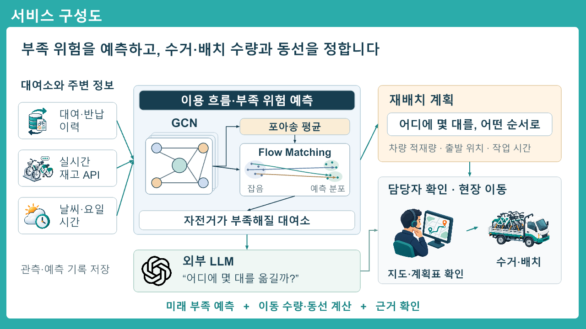

# 타슈 운영 도우미 서비스 구성도

대여·반납 흐름과 대여소 관계를 현재 재고 관측에 연결해 부족 위험을 읽는다. 차량 조건에 맞춰 이동 대수와 방문 순서를 계산하면, 담당자가 확인하고 자전거를 옮긴다. 새 재고가 들어오면 다시 계산한다.

외부 LLM은 전체 재배치 계획을 한 번에 설명한다. 현재 검증한 재고 예측 구간은 10분이며, 프로젝트는 관측·이용 흐름 예측·부족 위험·수량·동선·업무 질문을 연결하는 운영 도우미다. 예측값을 바꾸거나 배차를 실행하는 역할은 아니다.

발표 자료의 8번 슬라이드는 도형·텍스트·연결선으로 그렸다. GCN 그래프, Flow Matching 도식과 예측 결과를 크게 배치하고 작은 `h` 표시는 없앴다. 글자는 대부분 22~31 크기다. 생성한 자료·재고·날씨·담당자·차량 아이콘과 공식 OpenAI 아이콘은 각각 옮기고 크기를 바꿀 수 있다. 위 PNG는 미리보기다. 편집 원본은 워크시트의 슬라이드다.

GCN은 [Kipf & Welling, Figure 1](https://arxiv.org/pdf/1609.02907)의 그래프·특징 표현을 참고했다. Flow Matching은 [Lipman et al., Figures 2–3](https://arxiv.org/html/2210.02747v2)의 확률 경로·벡터장 표현을 참고해 개념도로 직접 그렸다. 실제 H13의 FM은 Gaussian 잡음에서 시작하며 포아송은 평균·조건이다. 그림의 점과 선은 실제 적합 결과나 차량 경로가 아니다.

[도형 작성 소스](../design/service-diagram-editable.mjs) · [개별 아이콘](../assets/service-icons/). 아이콘은 built-in ImageGen으로 만들었으며 프롬프트는 `design/service-icon-*-prompt.txt`에 보존했다. 이전 통합 비트맵 그림은 별도 버전으로 남긴다.

LLM의 GPT 표시는 사용자가 요청한 외부 모델 선택지를 나타낸다. 이번에 실제 검증한 외부 연결은 Antigravity이며 GPT API 연결 완료를 뜻하지 않는다. OpenAI Blossom은 [공식 배포본](https://cdn.openai.com/brand/openai-logos.zip)을 변경 없이 사용했다. 로고의 권리는 OpenAI에 있다. [공식 디자인 안내](https://openai.com/brand/).
