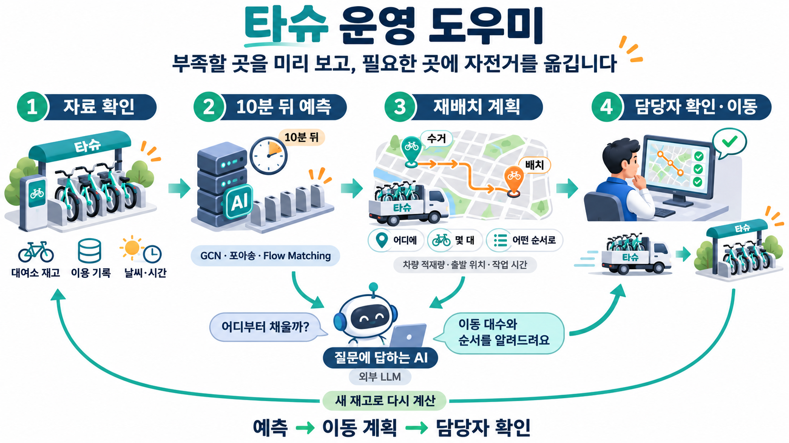

# 타슈 운영 도우미 서비스 구성도

대여소의 재고와 이용 기록을 보고 10분 뒤 부족할 곳을 예상한다. 차량 조건에 맞춰 이동 대수와 방문 순서를 계산하면, 담당자가 확인하고 자전거를 옮긴다. 새 재고가 들어오면 다시 계산한다.

질문에 답하는 외부 LLM은 예측과 이동 계획을 읽고 설명한다. 예측값을 바꾸거나 배차를 실행하는 역할은 아니다.

[PNG 원본](../assets/tashu-service-icons-v1.png) · [생성 프롬프트](../design/tashu-service-icons-prompt.txt)

사용자 제공 서비스 구성도 두 장의 목적과 표현 방식을 참고해 built-in ImageGen으로 새로 만든 설명 그림이다. 그림에 그린 자전거·차량은 아이콘이며 실제 배차 실적을 나타내지 않는다.
