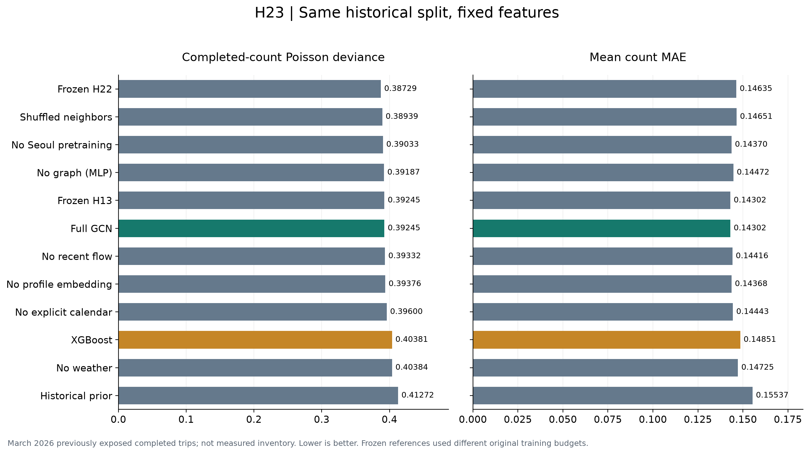
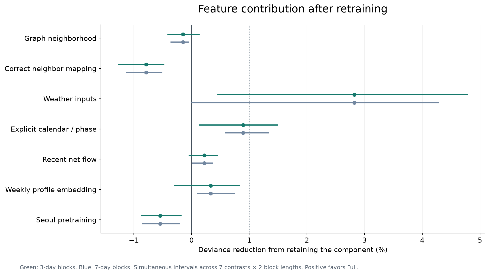
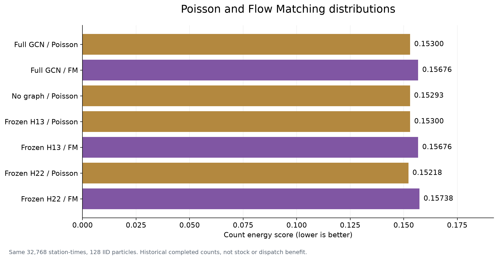

# H-0023 결과

## 가설

고정 특징을 모두 사용한 GCN이 2월에서 선택한 비그래프 대조군보다 3월 거래 deviance를1% 이상 줄이고 두 블록 구간의 하한이 양수인지 확인했다.

## 실험

dislab NVIDIA GeForce RTX 3080에서 특징8구성×2시드, XGBoost3.1.1, 포아송/FM과 기존 H13/H22를 비교했다. 학습은2월 전, 선택은2월, 시험은 이미 노출된3월이다. 시험은 같은 대여소·시각262,144개이며 분포 평가는32,768개×128표본이다. API는 열지 않았다.

신경망 제거 실험끼리는 같은 예산이다. XGBoost는 별도 고정 예산으로52만개 학습 표본과 최대500tree를 사용했다. 동일 계산량이나 동일 고유 표본 수의 비교는 아니다.

## 결과

주가설 판정: **not_supported**. 2월에서 선택한 대조군은 **No graph (MLP)**이며 full의 상대 deviance 감소는 **-0.148%**다.

| 모델 | 3월 count deviance ↓ | mean count MAE ↓ | prior 대비 deviance 감소 |
|---|---:|---:|---:|
| Frozen H22 | 0.387291 | 0.146351 | 6.161% |
| Shuffled neighbors | 0.389388 | 0.146509 | 5.653% |
| No Seoul pretraining | 0.390329 | 0.143697 | 5.425% |
| No graph (MLP) | 0.391874 | 0.144720 | 5.051% |
| Frozen H13 | 0.392454 | 0.143020 | 4.910% |
| Full GCN | 0.392454 | 0.143020 | 4.910% |
| No recent flow | 0.393324 | 0.144160 | 4.699% |
| No profile embedding | 0.393765 | 0.143681 | 4.593% |
| No explicit calendar | 0.395995 | 0.144431 | 4.052% |
| XGBoost | 0.403808 | 0.148509 | 2.159% |
| No weather | 0.403843 | 0.147252 | 2.151% |
| Historical prior | 0.412719 | 0.155366 | 0.000% |

이번 시험에서 deviance가 가장 낮은 모델은 **Frozen H22**다. 이 순위는 한 번의 시간 분할과 고정된 모델별 예산 안의 관측 결과이며 새 운영 모델 선택으로 자동 적용하지 않았다.

### 특징별 추가 가치

양수는 해당 요소를 유지한 full이 제거 모델보다 낫다는 뜻이다. 다른 입력을 남긴 상태에서 재학습한 조건부 비교이며 인과적 중요도가 아니다. 명시적 달력 제거 후에도 prior 안의 달력 정보는 남아 있다.

| 유지한 요소 | deviance 감소 | 3일 동시 구간 | 7일 동시 구간 | 판정 |
|---|---:|---|---|---|
| 이웃 전체 / GCN | -0.148% | [-0.409%, 0.133%] | [-0.355%, -0.056%] | no_demonstrated_1pct_gain |
| 올바른 이웃 대응 | -0.787% | [-1.268%, -0.481%] | [-1.123%, -0.517%] | no_demonstrated_1pct_gain |
| 기상 입력 | 2.820% | [0.456%, 4.780%] | [0.002%, 4.281%] | supported |
| 명시적 달력·10분 위치 | 0.894% | [0.138%, 1.485%] | [0.593%, 1.333%] | no_demonstrated_1pct_gain |
| 최근 순흐름 | 0.221% | [-0.041%, 0.446%] | [0.020%, 0.364%] | no_demonstrated_1pct_gain |
| 주간 임베딩 | 0.333% | [-0.291%, 0.833%] | [0.103%, 0.744%] | no_demonstrated_1pct_gain |
| 서울 사전학습 | -0.544% | [-0.861%, -0.185%] | [-0.850%, -0.212%] | no_demonstrated_1pct_gain |

### 포아송과 FM

| 구성 | count energy ↓ | 표본 중앙값 count MAE ↓ |
|---|---:|---:|
| full_poisson | 0.152998 | 0.103439 |
| full_fm | 0.156759 | 0.103920 |
| no_graph_poisson | 0.152933 | 0.103722 |
| locked_h13_poisson | 0.152998 | 0.103439 |
| locked_h13_fm | 0.156759 | 0.103920 |
| locked_h22_poisson | 0.152182 | 0.103256 |
| locked_h22_fm | 0.157379 | 0.103638 |

새 full에서 FM의 포아송 대비 energy 감소: **-2.458%**, 판정 **no_demonstrated_1pct_gain**.

### 해석 범위와 다음 행동

- 2·3월 거래 건수는 API 재고 정확도와 다른 지표다. 이번 시험으로 재고·0대 예측의 최종 우승자를 정하지 않는다.
- 기상 입력은 과거 시점 제약을 유지했지만 현재 운영 래퍼의 결측 기상과 다르다. 과거 거래 순흐름도 실시간 API 순재고 변화와 다르다.
- 새 특징을 늘리거나 GCN/FM을 기본 모델로 자동 교체하지 않는다. 유지 근거가 없는 요소는 후속 고정 입력 후보에서 단순화 대상으로 둔다.
- 실제 재고 후보는 과거 선택을 먼저 끝내고 별도 동결 계획으로9월 API 외부 평가를 한다. 같은 API로 구조를 반복 선택하지 않는다.
- 전체 추적값·시드별 점수·일별 집계·그룹 점수는 summary.json에 보존했다.

실행 353.7초. 원 실행 코드 `c299323f477bdeb9ea1e428477ad90024f231f0e`. 모델 가중치는 비공개 산출물로 보존하며 배포 가중치를 덮어쓰지 않았다.
