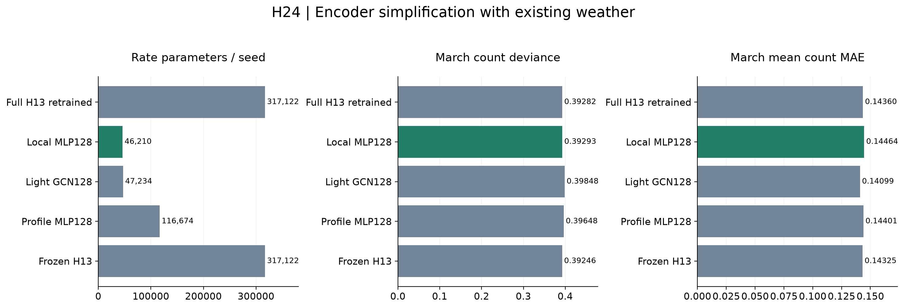
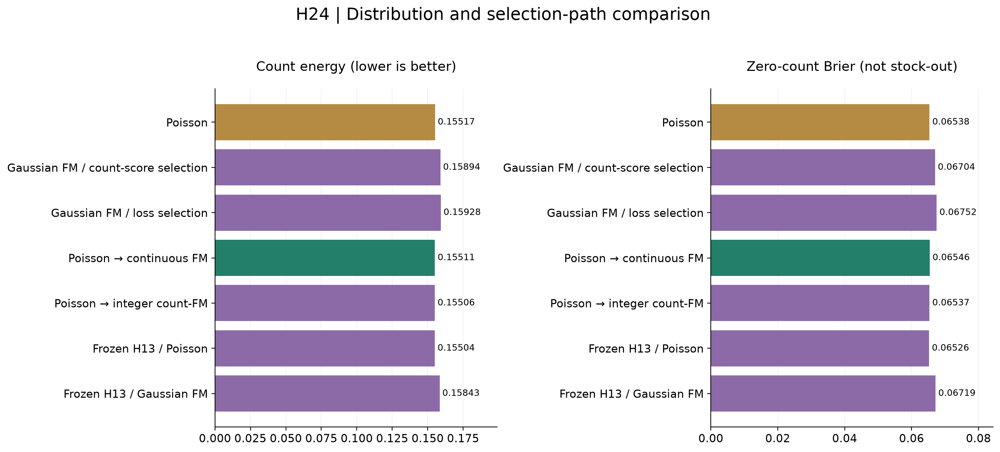
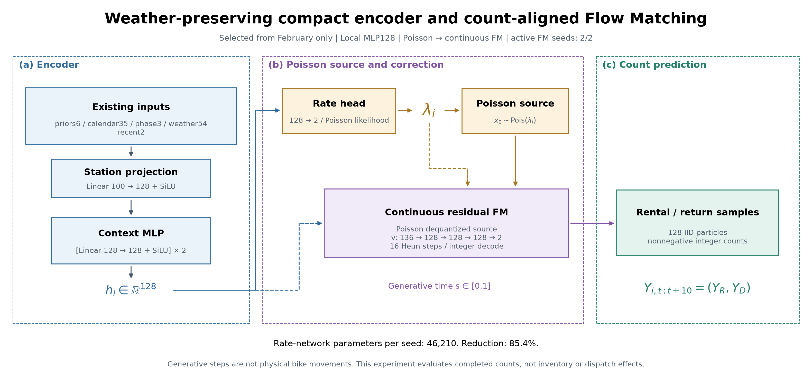

# H-0024 결과

## 가설

기상은 유지하고 encoder를 줄인 뒤, 건수 정합 FM이 포아송보다 분포 오차를1% 이상 줄이는지 검증했다. 무보정 선택은 FM 이득으로 세지 않았다.

## 실험

dislab NVIDIA GeForce RTX 3080에서 encoder4종×2시드, FM3학습 경로×2시드를 비교했다. Encoder는2월전반, decoder는2월후반에서 선택하고 잠근 뒤 이미 노출된3월을 평가했다. API를 열지 않았다. 총352.1초다.

최초 시도는 호출 인자 누락으로 첫 학습 checkpoint 전에 실패했다. 조건·예산·계획을 바꾸지 않고 인자만 수정했으며 원 시도 파일과기록을 보존했다.

## 결과

선택 encoder: **Local MLP128**. Rate parameter가 **85.43%** 줄었다. 선택 decoder: **Poisson → continuous FM**, epoch **[20, 15]**, 활성 FM **2/2**시드. 주가설 판정 **not_supported**.

| Encoder | seed당 rate parameters | March count deviance ↓ | mean count MAE ↓ |
|---|---:|---:|---:|
| Full H13 retrained | 317,122 | 0.392816 | 0.143600 |
| Local MLP128 | 46,210 | 0.392934 | 0.144643 |
| Light GCN128 | 47,234 | 0.398480 | 0.140990 |
| Profile MLP128 | 116,674 | 0.396481 | 0.144010 |
| Frozen H13 | 317,122 | 0.392461 | 0.143247 |

선택한 두 시드 encoder+FM 가중치는 **791,884바이트**, 총 **194,056개 파라미터**다. 과거 특성 cache는 이 크기에 포함하지 않았다. [모델 카드](model-card.json).

| Decoder | count energy ↓ | median count MAE ↓ | count fairCRPS ↓ | zero-count Brier ↓ | negative raw mass |
|---|---:|---:|---:|---:|---:|
| Poisson | 0.155172 | 0.105064 | 0.086752 | 0.065383 | 0.000% |
| Gaussian FM / count-score selection | 0.158938 | 0.105476 | 0.088317 | 0.067044 | 2.733% |
| Gaussian FM / loss selection | 0.159281 | 0.105484 | 0.088372 | 0.067521 | 2.752% |
| Poisson → continuous FM | 0.155111 | 0.104828 | 0.086691 | 0.065456 | 0.893% |
| Poisson → integer count-FM | 0.155055 | 0.105164 | 0.086677 | 0.065374 | 0.000% |
| Frozen H13 / Poisson | 0.155043 | 0.105118 | 0.086730 | 0.065262 | 0.000% |
| Frozen H13 / Gaussian FM | 0.158426 | 0.104874 | 0.087916 | 0.067185 | 2.771% |

선택 FM의 같은 encoder 포아송 대비 energy 감소: **0.039%**.
3일 블록95% 구간: [-0.291%,0.284%].
7일 블록95% 구간: [-0.234%,0.265%].

### 원인 분리

| 비교 | energy 감소 |
|---|---:|
| gaussian_score | -2.427% |
| gaussian_mse | -2.648% |
| poisson_continuous_score | 0.039% |
| count_jump_score | 0.075% |
| frozen_h13_poisson | 0.083% |
| frozen_h13_gaussian | -2.097% |
| gaussian_score_vs_mse | 0.215% |

### 수치 적분 검사

| 경로 | 같은8192표본 기본단계 energy | 추가단계 energy |
|---|---:|---:|
| gaussian_mse / 64steps | 0.154628 | 0.154491 |
| count_jump_score / 256steps | 0.149149 | 0.149304 |

추가 단계 점수는 진단이며 3월 점수로 실제 sampler를 선택하지 않았다. Zero-count는 대여/반납0건이며 대여소0대와 다르다.

### 선택한 구조

### 다음 행동

- 특징·모델 크기 확대는 하지 않는다. 배포H13과 관리자 경로는 유지한다.
- 작은 encoder는 검증 허용 오차와 parameter 기준으로 선택했으며 동일 성능을 증명한 것은 아니다.
- 무보정이 선택됐다면 활성FM 개선으로 발표하지 않는다. Gaussian 대비 개선과 Poisson 대비 개선을 구분한다.
- 모든 선택과 학습은 과거 기록만으로 마쳤다. 실제 재고 후보는 별도 동결 계획으로9월 외부 평가한다. API로 재학습·선택·보정하지 않는다.
- Count-FM은[원문](https://arxiv.org/html/2605.07746v3)의 정수 bridge와 rate matching을 조건부Poisson에 적용한 것이다. OT·CFG·원문 전체 재현을 주장하지 않는다.

실행 코드 `1066b3ed06269765f827f256141db6d572d758f4`. 시드·trace·실패·잠금·진단·전체 지표는 summary와manifest에 보존했다.
